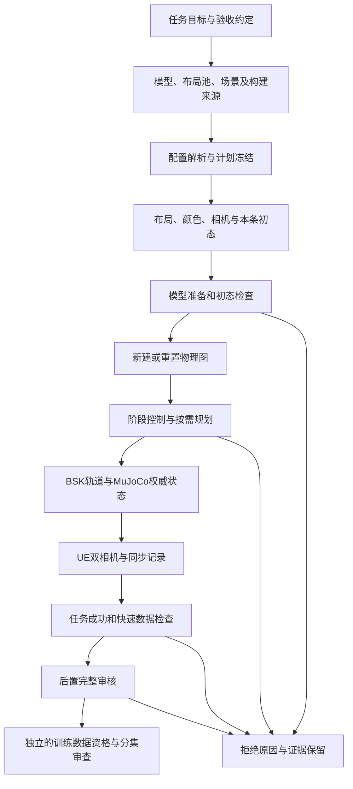

# 仿真与数据采集全流程对齐

核对日期：2026-10-31；实现基线：`30dea8f`。本指南面向任务定义、模型维护、仿真开发、采集运行和数据使用人员，把当前执行链与验收证据连接起来。后续代码变化须同步更新相应参考文档；本文不为旧批次补发认证。

## 文档入口与信息优先级

| 需要确认的内容 | 维护位置 |
|---|---|
| 全流程阶段、交接、异常处理、变更影响 | 本文 |
| 模型加载、轨道/局部动力学、物理参数、单位与坐标 | [物理模型与配置](../reference/physics-model-configuration.md) |
| 各入口配置优先级、种子、采样、录制、复用与资源预算 | [采集配置参考](../reference/collection-configuration.md) |
| 六类任务版本、完成阈值、录制验证、状态语义 | [任务与数据验收](../reference/task-and-data-acceptance.md) |
| 尚缺哪些标准、怎样补齐和判定完成 | [验证缺口与补齐条件](../reference/simulation-validation-gaps.md) |
| 每个新批次如何写清任务目标和验收约定 | [任务对齐记录模板](../templates/collection-task-contract.md) |
| 构建/源码/实际模块身份和恢复门禁 | [运行来源契约](../architecture/runtime-provenance.md) |
| 目录归属、文件命名、保留规则 | [项目地图](../project-map.md)、[命名规范](../naming-conventions.md)、[数据管理](data-management.md) |

**解释一个已存在的 episode 时，先看该条冻结配置、实际加载来源、任务版本及原始验收报告。** 当前源码解释当前行为；仓库默认配置解释新任务的缺省输入；旧实验文档只解释当时版本。发生冲突时登记差异，不用今天的默认值改写历史 metadata。

参数不能只记一个数字。至少记录：参数路径、含义、单位/坐标系、默认出处、覆盖入口、实际值、输出证据、相关检查、修改后的复验范围。三份参考文档按这个原则列出当前关键参数；每批记录只写实际选择和偏离，避免重复维护整套默认值。

## 当前执行边界

日常顺序批采入口为 [tools/collect.py](../../server/tools/collect.py)，使用 [collection.json](../../server/config/collection.json)。当前默认五种任务开启，航空螺栓关闭；1000 个布局轮次、每轮五次尝试，共 5000 次**尝试**，不保证 5000 条成功数据。网页/API、单条诊断、并行采集和交付包各有入口及默认值，不能自动套用该结论。



UE 负责渲染和图像采集，权威物理在仿真端。物理模型、用于状态发布的精简模型、UE 映射和可见资产分别追踪；“视频能显示”不能证明碰撞、螺纹、惯量或轨道配置正确。

## 分阶段交接表

表中“职责”表示需要有人承担的工作，不代表已经设置审批系统或分配具体人员。填写任务记录时指定实际负责人。

| 阶段/职责 | 输入及权威入口 | 输出证据 | 通过条件与异常处理 |
|---|---|---|---|
| 任务定义：任务/数据使用方 | 任务名、目标部件、操作语义、任务版本、目标覆盖范围 | 任务对齐记录；明确用途为性能诊断、功能验收或训练候选 | 任务成功定义与下游需要一致；未定义的训练阈值显式待定 |
| 环境与构建：工程维护 | Python/Basilisk/MuJoCo/native、UE/插件、资产；来源门禁 | native/UE manifest、运行身份、实际 UE 模块报告 | 源码与构建、ABI、实际加载身份一致；失败修复构建或输入，不绕过门禁 |
| 模型与布局：模型维护 | MJCF及依赖、catalog、布局池、轨道/场景、物理配置 | 布局池哈希与几何结果、模型变体与物理装配报告 | 依赖完整、几何合格；全流程任务成功另验。旧池兼容不等于重新认证 |
| 计划冻结：采集运行 | 解析后的配置、源场景、布局池、实际 seed | `config.snapshot.json`、`plan.json`、`source-scene.json`、`inputs.json`、`pool.snapshot.json` | 数量、顺序和种子可追溯；配置/依赖变化则新建批次 |
| 布局与初态：采集/仿真 | 计划中的布局、颜色、相机及每条种子 | `layouts/.../initialization.json`、每条场景/随机化记录 | 同布局的颜色和相机按计划保持；初态关节限位及碰撞检查通过；拒绝保留原因 |
| 物理图准备：仿真维护 | 实际物理模型、组件配置、运行环境 | 动力学 `summary.json` 的装配、初始化、缓存/图复用字段 | 兼容才重置复用；输入改变重建。健康业务拒绝与运行异常分开处理 |
| 执行与同步录制：仿真/渲染 | 控制器、阶段规划、权威时间、相机/编码配置 | 任务状态、源数值、双相机视频、录制 metadata、运行来源 | 当前版本任务成功、正确启停和末帧屏障、状态/图像配对；错误不补录同次尝试 |
| 快速检查：采集运行 | 完成条目的 summary、帧数、时间和视频头 | 快速检查结果、`pending_audit` | 仅允许进入待完整审核；不能因此宣布训练合格 |
| 完整录制审核：数据维护 | 视频、数值源、数据表、任务版本 | `validation.json`、后置审核结果、批次进度 | 全解码、源数值/帧配对及对应任务规则通过才计 `accepted`；失败隔离到 `rejected/` |
| 训练资格：任务/数据使用方 | 已审核条目、视觉审查、物理证据、分布和分集计划 | 独立的数据集清单、纳入/排除原因、分集与审查报告 | 另行确认遮挡/颜色/指令、物理合理性、覆盖和防泄漏；当前没有统一的自动训练资格总门禁 |
| 归档交付：数据/工程维护 | 冻结输入、实际输出、所有审核与排除记录 | 不可变数据集/发布版本及可恢复依赖清单 | 可定位到原批次与构建；不通过修改原始 metadata 消除失败或升级认证 |

其中“后置完整审核”指现有录制验证器覆盖的范围，**不等于全过程 400 Hz 接触审计、全帧视觉语义审查或全部物理参数已做真实标定**。各验证器的实际范围见[验收参考](../reference/task-and-data-acceptance.md)。

## 新批次操作顺序

1. 在仓库外 `reports/<run-id>/task-contract.md` 填写[模板](../templates/collection-task-contract.md)，指定使用哪个入口、任务版本、布局覆盖、物理假设、录制配置和验收范围。
2. 核验运行来源和模型/布局依赖。配置中的路径解析、继承规则以[采集参考](../reference/collection-configuration.md)为准；尤其区分源场景中的实际轨道配置与新场景默认值。
3. 使用全新输出目录生成计划，核对解析后的整数 seed、任务顺序、布局轮次和总尝试数。`--plan-only` 会写入计划，但不启动 UE/动力学，也不等于运行环境已通过检查。
4. 运行前把需要复现的外部录制配置、场景和资产依赖纳入保留清单。现有快照/哈希不保证所有外部文件都已经被复制进批次。
5. 实际启动后记录 `launch-provenance.json`，并检查每条来源/实际 UE 报告。运行时保持源码、配置与构建目录稳定。
6. 监控批次状态、失败分类、磁盘、worker 回收和完整审核进度。统计总尝试、待审核、通过、失败/中断，不能只报成功率分子。
7. 完成后复核审核报告、覆盖范围与训练资格；保存报告和依赖。异常终止时先保全已生成证据，再按下面规则恢复。

以下为操作示例，本次文档整理没有执行采集。使用新目录替换占位路径；从 `server/` 执行，`python` 须为已安装仿真依赖的解释器。示例配置需设置 `passes=1`，并将 `adapter`、`unreal` 固定为与核验命令相同的绝对路径，保证核查与启动使用同一运行环境：

```bash
# 检查当前实现和构建；不启动正式采集。
python tools/deployment/check_runtime_provenance.py --adapter /absolute/space-sim/ue-adapter --unreal /path/to/UE_5.6
# 写入两布局的独立验收计划；创建输出目录并冻结seed。
python tools/collect.py --config /absolute/collection.json --output /absolute/new-run --layouts 2 --plan-only
# 核对计划后执行同版本计划；该命令会启动尚未尝试的任务。
python tools/collect.py --output /absolute/new-run --resume
```

`--layouts 2` 设置每遍两套布局并清除总轮次数覆盖，但不会把 `passes` 改为1；自定义配置有多遍时，仍会生成多遍任务。务必核对 `plan.json` 的总数。该示例不能代表整个布局池已验证，不要在已经停止并要求保留的正式批次上执行。

## 状态、停止与恢复

批次 `complete` 表示计划与审核阶段结束，允许其中存在 `skipped`；`completed_attempts` 包含待审核和跳过，不能当作最终通过数。单任务内部 summary 的 `accepted` 也可能同时带有 `full_validation_pending=true`；以布局调度的 `pending_audit` 和实际完整报告判断。具体字段见[状态对照](../reference/task-and-data-acceptance.md)。

正常停止通过批次 `cancel.request`，保留本次失败/取消记录。锁文件存在或 systemd 显示 failed 都不能单独证明还在采集，应核对本批进程/PID。恢复要求同一实现和冻结输入；更换实现建立新批次。恢复会跳过已尝试/中断的条目，运行未尝试条目，并处理待审核数据，不会自动补齐成功数。

决定恢复一个符合上述条件的批次后，保留停止记录并撤销该批 `cancel.request`；恢复命令不会自动删除它。不能删除来源门禁文件或用撤销取消标记来绕过版本不匹配；详见[停止与恢复语义](../reference/collection-configuration.md)。

**`--resume` 不是仅审核命令。** 需要审核已停批次时，使用适用版本的数据验证器或独立审计程序，将新审核结论另存并保留原始状态；不能为了审核而启动剩余采集，也不能删 provenance 或取消标记来绕过来源核验。

## 修改时需要一起对齐什么

| 修改对象 | 一起核对的配置/实现/文档 | 有效复验依据 |
|---|---|---|
| 物理模型、碰撞、质量/惯量、螺纹或保持力 | MJCF依赖及哈希、物理装配、模型参考、布局池/UE映射 | 原生物理夹具、几何/接触、冷启动与重置、受影响完整任务；画面通过不替代物理验证 |
| 成功阈值、控制状态机、任务目标 | 任务版本、在线判定、采后验证、英文指令、验收参考 | 当前/历史版本规则、成功失败边界、完整操作和记录终点；阈值变更不称物理等价优化 |
| 采样、分辨率、相机或力传感 | 时间调度、协议、writer、数据特征/单位、配置参考 | 源数值、帧配对、完整视频、标定和真实画面 |
| 性能、缓存、worker/图复用 | 运行参数、兼容键、reset、来源身份、性能统计 | 同输入冷/热严格对照、成功→拒绝→成功、真实完整录制、含审核的墙钟 |
| 随机化或布局选择 | 实际seed、计划、颜色/孔身份、初态、任务指令 | 同seed计划复现、覆盖分布、渲染实图、跨数据集隔离 |
| UE/协议/native/依赖升级 | 构建清单、实际模块、环境/ABI、发布和来源文档 | 基础、native、UE、GPU、完整任务及适用平台分层报告 |
| 文档或命名调整 | 链接、地图、参数引用及历史边界 | 本地链接/代码对照；纯文档变化不重新授予运行认证 |

## 目前证据能支持什么

2026-10-31 的主目录固定布局五任务验收为 5 `accepted`、0 待审核、0 跳过，两路共 38,732 帧图像全解码，源数值及帧配对通过，总墙钟 779.90 s（含完整审核 72.31 s）。原始证据位于本机 `reports/ue-engineering-implementation-20261031/recording-acceptance.json`；详细边界见[工程实施说明](../ue-engineering-improvement-plan.md)。

该结果只覆盖一个冻结布局与五个任务。它不能证明航空螺栓、全部 150 套布局、长时间稳定性或所有图像的视觉语义均已合格。最终 DebugGame 来源门禁补丁有单独的验证与来源记录，不能把它的指纹回写到此前录像。待补内容、完成条件和证据位置统一登记在[验证缺口](../reference/simulation-validation-gaps.md)。
