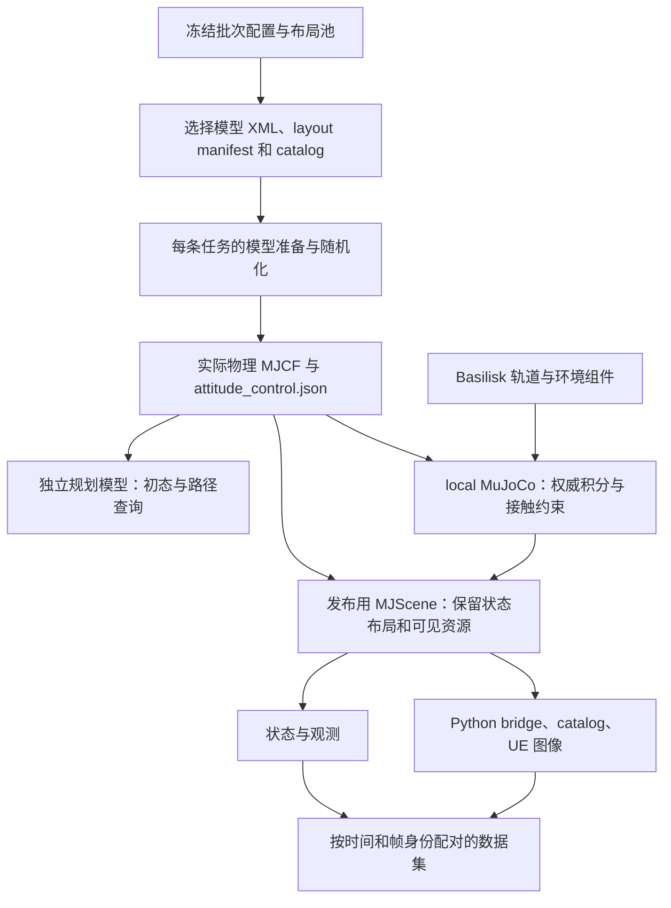

# 物理模型加载、配置与验收

核查日期：2026-10-31；代码依据为主仓库 `30dea8f89765ff3530c6b08b730891bf8ee92c42` 及本页链接的实现。本文说明仿真和数采实际使用的物理链路，不将某份模型文件、历史示例默认值或测试通过记录当作所有批次的运行配置。本次文档审计没有启动仿真或改写采集数据。

任务交接见[全流程指南](../guides/simulation-data-workflow.md)，入口与参数合并见[采集配置参考](collection-configuration.md)，成功条件与录制验证见[任务与数据验收](task-and-data-acceptance.md)。

读取参数时按三个层次判断：**模型/配置声明了什么，入口和组件覆盖了什么，具体 episode 最终加载并保存了什么**。例如，默认任务盒 MJCF 写有 `timestep="0.001"`，正式动力学时钟是 `400 Hz`，原生步进器按收到的时间间隔除以子步数设置实际积分步长；单看 XML 不能得到实际运行频率。对应实现见[采样时钟](../../server/backend/space_arm_platform/sampling.py)、[Python 步进器](../../server/simulation/local_mujoco_stepper.py)和[原生步进器](../../server/native/local_mujoco_stepper.cpp)。

## 状态权威与职责

| 层次 | 当前职责 | 不能据此推断的内容 |
|---|---|---|
| Basilisk 调度与环境组件 | 调度物理/控制/观测；SPICE 星历；传播轨道参考点；提供地球/太阳引力模型、姿态控制及消息接口 | 使用 Basilisk 不表示所有刚体同时由 Basilisk 的积分器推进 |
| `local` MuJoCo 物理核心 | 积分 MJCF 多刚体的位姿/速度；求解接触、关节、腱和等式约束；执行伺服与外力 | 发布用 MJScene 的简化几何不能拿来代替此模型 |
| 发布用 MJScene | 接收当前权威状态，发布关节、刚体、site 与场景消息，维持现有接口 | 当前 `local` 路径不让它再次积分同一套多刚体状态 |
| UE Runtime | 按权威状态更新场景并采集相机图像；预览可使用插值/外推 | UE 帧率、预览流畅度及视觉碰撞不构成物理求解证据 |
| recorder / LeRobot writer | 按时间和帧身份配对图像、动作、状态与腕力，并封装数据 | 文件存在或视频可播放不表示物理任务成功或数据完整 |

代码依据：[DynamicsCoreComponent](../../server/simulation/components/dynamics_core.py)、[OrbitComponent](../../server/simulation/components/orbit.py)、[LocalMujocoStepper](../../server/simulation/local_mujoco_stepper.py)、[发布模型准备](../../server/simulation/publication_scene.py)、[权威采集传输](../../server/simulation/scripted_tasks/capture_transport.py)、[录制入口](../../server/collection/record_scripted_task.py)。

当前脚本数采在 `run_scripted_task.run()` 中明确选择 `dynamics_backend="local"` 和 `OrbitalGravityComponent(mode="bsk")`。遥操作入口允许解析 `local/basilisk` 和 `bsk/linear_tidal`，但联动夹爪 SARM 模型要求 `local`，配置 J2 或阻力还要求 `local+bsk`。不能通过设置 `SPACE_SIM_DYNAMICS_BACKEND` 就认为正式脚本数采已切换后端。依据：[脚本入口](../../server/collection/run_scripted_task.py)、[遥操作入口](../../server/simulation/teleop_grasp_unreal.py)、[轨道配置解析](../../server/simulation/orbital_configuration.py)。

## 模型从输入到实际运行的链路



### 正式数采

1. [tools/collect.py](../../server/tools/collect.py)进入[sequence.py](../../server/collection/sequence.py)，解析并冻结配置、整数 seed、布局池、源场景与任务计划。[LayoutPool](../../server/backend/space_arm_platform/collection_layouts.py)负责布局输入、资产及验收记录校验。
2. [collect_scripted_tasks.py](../../server/collection/collect_scripted_tasks.py)将选定的 `--model`、`--catalog`、scene 与单条输出交给[record_scripted_task.py](../../server/collection/record_scripted_task.py)。保存布局时必须有匹配的模型和 catalog，不能只改 scene 中的布局描述。
3. [run_scripted_task.py](../../server/collection/run_scripted_task.py)优先使用显式 `--model`，没有时才回退到 `server/model/SARM/platform/sarm_20261012.xml`。任务初态优先使用 `--initial-joints-deg`；否则，有 scene 时使用 `randomization.arm_joint_position_rad`；再否则使用平台操作初态。
4. `write_model_variant()` 根据任务执行颜色、动力学随机化、螺栓存放结构和锁杆初态等准备，返回真正使用的 XML；没有需要生成的变更时可直接返回源路径。它不会保证每次都存在一份新建的 `model.xml`。实际路径和 SHA 以 dynamics summary 的 `model`、`model_sha256` 为准。依据：[randomization.py](../../server/simulation/scripted_tasks/randomization.py)。
5. 入口从 UE `examples/scenario_spacecraft_arm_grasp_unreal.py` 导入 `load_native_grasp_module()`，再加载 `server/model/SARM/platform/scenarios/scenario_sarm_grasp.py`。这两个带“示例/场景”名称的文件仍是正式依赖。入口随后覆盖 `MODEL_PATH`、模型关节/执行器名称、控制增益和时钟，不能引用场景脚本顶部的旧默认值来描述当前数采。
6. 先用私有规划模型进行初态检查；通过后复用兼容物理图，或调用 `_build_simulation()` 创建新图。组件装配轨道、差分引力、关节参考、姿态保持、插头保持力及显式启用的阻力，初始化后应用本条初态。模块顺序由 [AssemblyContext / Slot](../../server/simulation/assembly.py)表达。
7. 渲染桥读取同一实际变体的材质/几何元数据，并使用选中布局的 catalog。`render_model_path`、`render_model_sha256` 用于证明渲染元数据对应哪个变体；不能用源模型的颜色代替本条实现的颜色。

其中 `--model` 还要求同目录存在 `attitude_control.json`；录制模式会检查选中布局 manifest 与 scene 的 `task_box_layout` 一致。直接运行诊断脚本和完整录制的输入要求不同，见[脚本参数及校验](../../server/collection/run_scripted_task.py)。

### 遥操作与原始示例

[teleop_grasp_unreal.py](../../server/simulation/teleop_grasp_unreal.py)从 scene 的模板选择 [scene_targets.py](../../server/backend/space_arm_platform/scene_targets.py)中的模型；显式模型覆盖优先。关节限位从选中模型读取，联动夹爪由 [sarm_model_profile.py](../../server/simulation/sarm_model_profile.py)识别。网页场景、旧原始抓取示例、批采任务没有完全相同的默认配置。

兼容加载器会先建立 Basilisk/MuJoCo 的加载顺序，拒绝在其前面加载已经具有 `MjModel` 的 Python `mujoco` 模块。Linux 原生 helper 复用 Basilisk 已加载的 MuJoCo 共享库，Windows 使用 Basilisk 对应的运行库。普通 Python `mujoco` 安装成功不能替代 `Basilisk.simulation.mujoco.MJScene`。依据：[加载器](../../ue-adapter/Unreal/BskUnrealRenderer/examples/scenario_spacecraft_arm_grasp_unreal.py)、[运行库发现](../../server/simulation/mujoco_runtime.py)。

## 时钟、积分与参数覆盖

下表的默认是当前实现的解析结果；某一批次仍需核对启动参数、环境变量和保存的 telemetry。

| 参数 | 当前正式路径/默认值 | 覆盖与实际证据 | 代码依据 |
|---|---|---|---|
| 物理外层频率 | `400 Hz`，每步 `0.0025 s` | 正式入口设置 `TIME_STEP`；有理时钟检查实际纳秒时间，不按墙钟累加 | [sampling.py](../../server/backend/space_arm_platform/sampling.py)、[physics_clock.py](../../server/simulation/physics_clock.py) |
| 脚本任务控制 | `200 Hz` | summary 的 `task_hz` 与 `schedule`；不同于物理子步 | [run_scripted_task.py](../../server/collection/run_scripted_task.py) |
| 遥操作 IK | 默认 `100 Hz` | 无 scene 时使用 `--ik-rate`；有 scene 时其 `runtime.ik_rate_hz` 覆盖；必须是物理频率的整数因子，还需满足装配的发布相位约束 | [teleop_grasp_unreal.py](../../server/simulation/teleop_grasp_unreal.py)、[sampling.py](../../server/backend/space_arm_platform/sampling.py) |
| 渲染/当前正式 RGB | `50 Hz` | 脚本录制明确要求双相机 `50 Hz RGB`；通用配置类允许的其他频率不能直接套入该脚本 | [sampling.py](../../server/backend/space_arm_platform/sampling.py)、[recording_settings](../../server/collection/record_scripted_task.py) |
| 独立腕力采样 | `200 Hz` | 保存测量相位和时间，不能把它当成全部物理子步极值 | [sampling.py](../../server/backend/space_arm_platform/sampling.py)、[wrench_sensors.py](../../server/simulation/wrench_sensors.py) |
| local 子步数 | 默认 `1`，允许 `1..16` | 显式参数优先于 `SPACE_SIM_LOCAL_SUBSTEPS`；批采构造 recorder 命令时明确传 `--substeps 1`；独立任务默认参数为 `None`，才走环境/default 解析 | [local_dynamics_config.py](../../server/simulation/local_dynamics_config.py)、[collect_scripted_tasks.py](../../server/collection/collect_scripted_tasks.py)、[run_scripted_task.py](../../server/collection/run_scripted_task.py) |
| 实际积分步长 | 当前时间间隔 / 子步数 | `lms_step` 设置 `m->opt.timestep = dt / substeps`，覆盖 XML 原始步长 | [local_mujoco_stepper.cpp](../../server/native/local_mujoco_stepper.cpp) |
| 刚体/site 发布间隔 | 默认每 `8` 个物理步，即 `50 Hz`；允许 `1,2,4,8` | `SPACE_SIM_LOCAL_PUBLISH_STRIDE`；bulk 状态、关节消息仍每物理步更新；summary 保存实际 stride | [local_dynamics_config.py](../../server/simulation/local_dynamics_config.py)、[local_mujoco_stepper.py](../../server/simulation/local_mujoco_stepper.py) |
| 差分轨道力更新间隔 | 平台组件默认 `8` 个物理步，期间保持 | `SPACE_SIM_ORBITAL_FORCE_STRIDE`，允许 `1..400`；`1` 在每子步求值；直接构造 stepper 的行为须看构造参数 | [OrbitalGravityComponent](../../server/simulation/components/orbital_gravity.py)、[local_mujoco_stepper.py](../../server/simulation/local_mujoco_stepper.py) |
| local 积分器/均匀重力 | 强制 `implicitfast`；本地模型均匀重力为零 | 零均匀重力不表示关闭在轨引力：轨道参考点与差分力在其他组件中计算 | [local_mujoco_stepper.cpp](../../server/native/local_mujoco_stepper.cpp) |
| `basilisk` 参考路径积分 | `RKF45`，相对/绝对容差默认均 `1e-4` | `SPACE_SIM_RKF45_RELATIVE_TOLERANCE` / `SPACE_SIM_RKF45_ABSOLUTE_TOLERANCE`；不控制当前 local 积分器 | [native_integration.py](../../server/simulation/native_integration.py) |

`RationalPhysicsClock` 使用绝对 tick 的四舍五入纳秒值，并核对任务执行时间。装配顺序是时钟→轨道/环境→命令/控制→执行器→物理核心→传感/记录→输出。物理核心前的模块读前一已发布状态，之后的模块读当前状态；分频组件还显式约束 phase。实时倍速、视频编码速度和 GPU 帧率不改变这个物理时钟。依据：[assembly.py](../../server/simulation/assembly.py)、[physics_clock.py](../../server/simulation/physics_clock.py)。

## 轨道、局部坐标与外力

### 默认轨道不是每个批次的实际轨道

[teleop_grasp_unreal.py](../../server/simulation/teleop_grasp_unreal.py)中的 fallback 为：高度 `500000 m`、偏心率 `0`、倾角 `51.6°`、升交点赤经 `0°`、近地点幅角 `0°`、真近点角 `180°`；星历历元为 `2026 SEPTEMBER 02 00:00:00.000`。实际 scene 可覆盖 `environment.orbit` 和 `environment.ephemeris_epoch_utc`，随机化还可改变初始轨道相位。应查看保存的 scene 和 dynamics summary 的 `orbit`、`orbital_physics`，不能从默认值反推历史批次。

`altitude_m` 在初态转换中用于 `a = earth.radEquator + altitude_m`，即设定半长轴；偏心轨道的当时离地高度另由位置范数计算。母体初速度还会加上场景模块的 `COMMON_VELOCITY=[0.01,-0.004,0.002] m/s`，目标速度则是轨道速度加其保存的相对速度。`orbit.initial_velocity_m_s` 报告的是母体速度，不应误认为轨道参考点 O 的纯轨道速度。依据：[初态转换](../../server/simulation/teleop_grasp_unreal.py)和[场景常量](../../server/model/SARM/platform/scenarios/scenario_sarm_grasp.py)。

中心/惯性系使用 Earth/J2000，天体固连方向使用 SPICE 的 `IAU_EARTH`、`IAU_SUN`。地球引力常数和半径从 Basilisk 的真实 `GravBodyData` 读取，并写入 `environment_metadata()`，不是在本文另列一组可能与运行库漂移的常数。

### 引力配置的优先级

`resolve_orbital_physics()` 按显式配置文件 override → scene 的 `environment.physics` → 入口规则解析。**传入的旧 scene 缺少 `environment.physics` 时采用 point mass；没有 scene 且是 local+bsk 时才采用新默认 J2。** 当前脚本入口始终传 scene 字典，因此不能把“缺 physics”解释成自动升级旧数据。

新配置类默认 `earth_gravity="j2"`、`j2_coefficient=1.082616e-3`、`drag=null`；系数来源字符串保存为 Basilisk `2.11.1 astroConstants.J2_EARTH`，该字符串是系数来源，不证明实际安装包版本。J2 使用归一化 `C20=-J2/sqrt(5)`，太阳为点质量源。依据：[OrbitalPhysics](../../server/backend/space_arm_platform/orbital_physics.py)、[orbital_configuration.py](../../server/simulation/orbital_configuration.py)、[OrbitComponent](../../server/simulation/components/orbit.py)。

遥操作通过 `--orbital-config` 显式覆盖；当前脚本数采没有同名覆盖参数，使用 scene 保存的配置。`linear_tidal` 是显式回归模式，不是当前脚本采集默认。

### local 的物理含义

局部系 L 的原点 O 随轨道参考点平移，坐标轴保持与 J2000 平行，**不是随轨道旋转的 LVLH 系**。因此不能再次叠加 LVLH 的科氏/离心项。对每个有质量刚体的质心，BSK 原生场模型计算并提供：

```text
F_i = m_i × Σ_sources [ a_source(r_O + x_i) − a_source(r_O) ]
```

O 和各刚体共享同一组 BSK 引力源。原点在已接受轨道区间内通过 Hermite 插值采样；星历短时间采样采用位置/速度外推及方向投影。它们是接口采样方法，不是第二套多刚体积分器。依据：[orbital_environment.py](../../server/simulation/orbital_environment.py)、[orbital_frames.py](../../server/simulation/orbital_frames.py)。

local 每 `400` 步检查一次系统质心偏移，默认超过 `50 m` 时重定局部原点，同时变换局部坐标与原点状态，保持惯性状态不变。这是数值坐标管理，不是把物体拉回初始位置。参数与实现见 [local_mujoco_stepper.py](../../server/simulation/local_mujoco_stepper.py)。

外部力接口使用质心处、惯性轴表达的力和刚体轴表达的力矩；多个 source 相加。当前轨道 metadata 明确 `gravity_gradient_torque=false`：逐刚体质心差分力会形成多刚体系统的空间力效应，但没有额外实现单个扩展刚体的引力梯度力矩。依据：[physics_ports.py](../../server/simulation/physics_ports.py)、[orbital_configuration.py](../../server/simulation/orbital_configuration.py)。

### 阻力与可选扰动

阻力默认关闭。启用时必须明确密度参考高度、参考密度、标高，以及每个受力刚体的有效面积、Cd 和参数来源；缺参数不能只靠开关补齐。配置阻力使用 SPICE 天体运动求共转大气速度，作用力为 `−0.5 ρ Cd A |v_rel| v_rel`；组件默认每 `40` 个物理步求值，即 `10 Hz`，期间保持。

[config/orbital](../../server/config/orbital)中的阻力示例标明 SYNTHETIC，仅用于灵敏度试验，不是经过标定的真实航天器大气/气动数据。[BallisticBody](../../server/backend/space_arm_platform/orbital_physics.py)当前只暴露等效面积/Cd；更一般的质心外压力中心、遮挡与面元气动不应从这一配置推定为已支持。组件能力和场景公开配置的范围不同，详见 [drag.py](../../server/simulation/components/drag.py)。

## MJCF、接触、约束与执行器

### 模型中保留的物理内容

质量/质心/惯量、碰撞几何与分解、关节轴/限位、阻尼、armature、contact pair、排除对、等式约束、腱和传感器均来自选中的实际 MJCF。布局池模型和任务变体可与默认文件不同，不存在适用于全部场景的一组“固定总质量/惯量”。

下面仅列仓库 [sarm_20261012.xml](../../server/model/SARM/platform/sarm_20261012.xml)的代表性声明，不能替代运行模型的编译结果：

| XML 项目 | 该文件声明 | 解读边界 |
|---|---|---|
| compiler | `angle=radian`、`meshdir=.`、`autolimits=true`、`inertiafromgeom=auto`、`fusestatic=false` | 资产实际缩放、显式 inertial 和继承 default 仍需逐项解析 |
| option | `gravity=0 0 0`、`timestep=0.001`、`integrator=implicitfast`、`solver=Newton`、`cone=elliptic`、`tolerance=1e-10`、`impratio=5` | 步长/重力/积分器存在上述运行覆盖；未显式列出的 MuJoCo 选项使用当前运行库默认 |
| robot_joint class | `damping=0.1`、`armature=0.01`、`limited=true` | 只对继承该 class 且未覆盖的关节生效，不是所有被动/自由关节参数 |
| robot/object geom class | `condim=4`、`friction=1.2 0.02 0.0001`、`solref=0.001 1`、`solimp=0.99 0.999 0.001` | geom/pair/default 继承与显式覆盖都可能改变最终接触；不能仅查看此行 |
| 连杆夹爪 | 两个 connect 约束、主动关节反向 coupling、固定 tendon | 被动连杆不是额外独立伺服轴 |
| 螺纹机构 | `fastener_helix` 关节等式及 SARM SDF 资源 | 还需结合任务准备的闭合初态和接触声明，不能用视觉螺纹证明物理啮合 |

本地物理核心禁用 MuJoCo 自动重置；发散和干摩擦不收敛会作为错误上报。发布副本则单独关闭 contact/constraint，替换明确不可见且无质量的碰撞几何，并保留状态/可见资源映射。**发布副本“关闭接触”不等于物理核心关闭接触。** 依据：[native/local_mujoco_stepper.cpp](../../server/native/local_mujoco_stepper.cpp)、[publication_scene.py](../../server/simulation/publication_scene.py)。

### 控制参数的实际覆盖

正式脚本和当前联动夹爪 SARM 遥操作将机械臂六轴设置为 `kp=500`、`kd=50`、对称力矩限幅 `±100 N·m`。原生 `lms_set_servo()` 改写对应 actuator 的 gain、bias、force limit，并使用位置/速度参考构成隐式 PD：

```text
τ = clip(kp × (q_ref − q) + kd × (qd_ref − qdot), −limit, +limit)
```

其中转动关节的 `kp` 对应 N·m/rad、`kd` 对应 N·m·s/rad。默认 XML 的部分 `forcerange` 不同，例如 joint2 声明 `±200`，仍会被这一伺服安装过程覆盖。因此应同时审查入口和 actuator 配置，不能只读 XML。依据：[run_scripted_task.py](../../server/collection/run_scripted_task.py)、[teleop_grasp_unreal.py](../../server/simulation/teleop_grasp_unreal.py)、[lms_set_servo](../../server/native/local_mujoco_stepper.cpp)。

联动夹爪通过 `ee_fingers_position` 腱 actuator 接收参考，保留其 MJCF 参数。上述默认模型写有 `gear=0.5`、`kp=200`、`kv=20`、`ctrlrange=0..1`、`forcerange=±200`；这不是手指实际夹持力固定为该值的声明，实际接触力还依赖机构传动和求解状态。依据：[模型](../../server/model/SARM/platform/sarm_20261012.xml)、[gripper_control.py](../../server/simulation/gripper_control.py)。

轨迹速度、加速度、力限、安全终止阈值和任务完成条件属于任务控制层；它们不直接替代物理接触。分别由 [drawer_cycle.py](../../server/simulation/scripted_tasks/drawer_cycle.py)、[plug_insert.py](../../server/simulation/scripted_tasks/plug_insert.py)、[plug_profiles.py](../../server/simulation/scripted_tasks/plug_profiles.py)、[threaded_tasks.py](../../server/simulation/scripted_tasks/threaded_tasks.py)及 [motion_options.py](../../server/simulation/scripted_tasks/motion_options.py)解析，实际任务参数保存在 summary 的 `config`。不能将一种任务的 force limit 写成所有模型的材料承载上限。

### 姿态保持、插头保持与螺纹准备

姿态控制读模型同目录的 [attitude_control.json](../../server/model/SARM/platform/attitude_control.json)。该默认文件启用 `initial_inertial_hold`，控制频率 `50 Hz`、MRP 比例增益 `8 N·m`、角速率微分增益 `12 N·m·s`、转速保护比例 `0.98`。真实轮轴、转动惯量、限矩与速度来自 MJCF 硬件；控制驱动实体转子，不另给母体凭空施加一份姿态力矩。惯量装配排除独立自由飞行目标，锁定初态的姿态参考和装配惯量。详见 [attitude_control.py](../../server/simulation/attitude_control.py)。

插头保持力从显式函数参数路径 → `SPACE_SIM_PLUG_RETENTION_CONFIG` → [config/plug_retention.json](../../server/config/plug_retention.json)解析。默认文件启用，显式给出静/滑动摩擦各 `20 N`、有效行程 `0.008 m`、扭转阻尼 `0.02 N·m·s/rad`；未列的横向、旋转引导等参数由 [RetentionParameters](../../server/simulation/plug_retention.py)补齐。只有模型具有受支持 socket 绑定且使用 local 时才安装。轴向干摩擦在原生子步内求解，基体与插头作用/反作用成对施加；它是配置的保持/导向模型，不等同于仅由 mesh 表面摩擦自然产生的保持力。最终全部参数及 socket 位姿写入 `plug_retention.configuration()`。

[write_model_variant](../../server/simulation/scripted_tasks/randomization.py)对螺栓存放处调用 [bolt_storage_thread.py](../../server/simulation/model_preparation/bolt_storage_thread.py)，对锁杆循环调用 [threaded_task_initialization.py](../../server/simulation/model_preparation/threaded_task_initialization.py)，并记录模型准备元数据。锁杆使用 MJCF joint ref 和匹配静止变换表达任务初态，不能把它误解成运行中直接改 qpos 来完成拧紧。SARM SDF 必须经 [mujoco_plugins.py](../../server/simulation/mujoco_plugins.py)核对运行库、插件库及源指纹后加载。

### 碰撞优化的边界

常驻采集 [dynamics_worker.py](../../server/collection/dynamics_worker.py)对未设置的 `CYLINDER_FILTER_MODE`、`MESH_FILTER_MODE`、`THREAD_FILTER_MODE` 使用 `2`。原生定义 `0` 为关闭、`1` 为 shadow 对照、`2` 为跳过已证明分离的碰撞候选；独立进程未经过 worker 时，原生默认是 `0`。这些模式不是“把碰撞全部关闭”，无法证明分离的情况回到原求解器。依据：[原生碰撞分离实现](../../server/native/local_mujoco_stepper.cpp)。

规划模型、发布模型、实际物理模型的“简化/优化”含义不同。预检和路径检查在私有模型上做有限关节采样，不是精确连续碰撞检测；实际执行仍应看 live 接触与任务判据。依据：[environment_motion.py](../../server/simulation/scripted_tasks/environment_motion.py)、[planning_context.py](../../server/simulation/scripted_tasks/planning_context.py)及 [run_scripted_task.py](../../server/collection/run_scripted_task.py)保存的 `environment_planning`。

## 初态、随机化与图复用

平台操作初态默认六轴为 `[90,-60,60,0,-90,0]°`，顺序批采配置类默认独立扰动半范围 `30°`。模型关节限位和初态几何预检仍必须通过，随机值落在抽样范围不代表其可执行。依据：[control_defaults.py](../../server/backend/space_arm_platform/control_defaults.py)、[sequence.py](../../server/collection/sequence.py)、[task_initialization.py](../../server/simulation/scripted_tasks/task_initialization.py)。

初态应用还包含显式归一化：六轴关节初速度置零；目标角速度向量的范数若大于 `1e-12 rad/s`，当前实现会将其归零，以避免已知 MJScene 初始姿态/自旋组合问题。配置里出现非零 `target_angular_velocity_rad_s` 因此不等于实际已加载非零自旋；该能力仍需专门验证与实现。应以 `initial_state.qvel` 和实际报告核对，见 [_apply_orbital_initial_state](../../server/simulation/teleop_grasp_unreal.py)。

动力学随机化配置类默认**未启用**；启用后默认质量/惯量与接触摩擦各按 `±5%` 范围采样。质量和惯量一致缩放，几何不因该选项改变。实际倍率在 `realized_randomization` 保存，模型 source/variant SHA 在 `model_randomization` 保存。观测噪声只影响相应观测字段，action noise 和 external disturbance 则分别进入控制参考和物理外力；这些开关不可混为一类“噪声”。参数范围是工程约束，不是已标定硬件噪声。依据：[collection_randomization.py](../../server/backend/space_arm_platform/collection_randomization.py)、[randomization.py](../../server/simulation/scripted_tasks/randomization.py)、[disturbances.py](../../server/simulation/scripted_tasks/disturbances.py)。

`seed=null` 的新顺序批次会对启动纳秒时间做 SHA-256 映射后生成支持范围内的整数 seed 并冻结；不是硬件真随机的承诺。每条任务和不同随机化项使用保存的 seed/命名随机流。恢复使用既有计划，不能重新采样而仍称同一批次。依据：[sequence.py](../../server/collection/sequence.py)、[randomization.generator](../../server/simulation/scripted_tasks/randomization.py)。

“后续任务只 reset”有明确条件：[PhysicsGraphCache](../../server/simulation/scripted_tasks/physics_graph.py)比较实际模型/资产/运行库指纹、环境、相机、catalog、姿态配置、子步、发布间隔与端口。外部扰动或阻力导致特殊装配时不复用；模型/任务变体、相机或环境发生变化也可能重建。记录 `physics_graph_reused`、`physics_graph_id`、`physics_graph_miss_reason` 和各初始化阶段耗时，不能凭“同一进程”认定图已复用。

复用时重置 native episode、控制/摩擦等状态、时钟、被动/自由自由度和通信 session，再应用本条初态；不会继承前条完成姿态。模型编译缓存与完整图复用是不同层次：[compiled_model_cache.py](../../server/simulation/compiled_model_cache.py)只缓存可识别的独立 MJCF 编译内容，带 include 或未知插件的模型会拒绝该缓存路径；缓存命中不等于省略每条状态初始化。

## 单位、坐标与传感器时间

| 数据 | 契约 | 实现依据 |
|---|---|---|
| 物理量 | 长度 m、质量 kg、时间 s；力 N、力矩 N·m；关节角/角速度通常 rad、rad/s；带 `_deg` 的配置在入口转换 | [physics_ports.py](../../server/simulation/physics_ports.py)、[run_scripted_task.py](../../server/collection/run_scripted_task.py) |
| 模型姿态 | MJCF quaternion 采用 wxyz；Basilisk 接口同时使用被动 `C_BN` / MRP，桥接时转换为主动旋转 | [frames.py](../../ue-adapter/Adapters/bsk_render_adapter/frames.py)、[scenario_sarm_grasp.py](../../server/model/SARM/platform/scenarios/scenario_sarm_grasp.py) |
| 物理局部系 | 平移原点、轴与惯性系平行；局部坐标与惯性坐标通过 O 转换 | [orbital_frames.py](../../server/simulation/orbital_frames.py)、[local_mujoco_stepper.py](../../server/simulation/local_mujoco_stepper.py) |
| UE 空间 | 默认每米 `100` 厘米，并镜像局部 Y 轴以适配 UE 坐标惯例；旋转做相应共轭转换 | [BskCoordinateConverter.h](../../ue-adapter/Unreal/BskUnrealRenderer/Plugins/BskUnrealRuntime/Source/BskUnrealRuntime/Public/BskCoordinateConverter.h)、[实现](../../ue-adapter/Unreal/BskUnrealRenderer/Plugins/BskUnrealRuntime/Source/BskUnrealRuntime/Private/BskCoordinateConverter.cpp) |
| 仿真时间 | 整数纳秒；时间戳对应权威状态 tick，不能用视频墙钟或到包时间替代 | [sampling.py](../../server/backend/space_arm_platform/sampling.py)、[capture_transport.py](../../server/simulation/scripted_tasks/capture_transport.py) |
| 腕力 | 原始接口 wrench，sensor site 坐标，MuJoCo force/torque 符号约定 | [wrench_sensors.py](../../server/simulation/wrench_sensors.py) |
| 腕力相位 | `last_substep_start`，另存 `interval_end_time_ns`；不伪装成区间结束时重新求解的传感器读数 | [LocalMujocoStepper.read_wrench](../../server/simulation/local_mujoco_stepper.py)、[wrench_sampling.py](../../server/simulation/wrench_sampling.py) |

“腕力最大值”需附采样范围：脚本 summary 标明它是任务采样中的最大值，不是所有积分子步的峰值。关节观测延迟与 RGB/腕力的采样时钟也不能互换，实际启用的随机化和测量时间必须随数据保存。

## 模型资产、便携性与身份

| 输入/产物 | 存放与责任 |
|---|---|
| 原始/平台模型 | `server/model/` 中的 MJCF、CAD、mesh、来源清单；按 Git/LFS 管理，不能因未直接渲染就删除碰撞输入 |
| 布局池 | 仓库外的数据输入；包含模型、catalog、布局声明、资源哈希及原生验收绑定 |
| 实际任务变体 | 本条记录/动力学输出中保存的模型和来源 SHA；可能仍引用外部资产，不能只复制 XML 就认定可跨机重放 |
| 原生库 | `server/run/native_acceleration/` 的库和 manifest；源、运行库/ABI及真实库内容都需核对 |
| UE catalog / Content | catalog 连接模型几何与 UE 资源；视觉资源与物理碰撞资源用途不同，各自有完整性责任 |
| 发布输入 | 明确 Cook manifest 和独立 staging；有物理布局包不表示已经得到可独立启动的 UE 包 |

`_load_scene()` 检查网格存在以及是否仍是 Git LFS pointer。原生 helper 检查 ABI/header，当前 local 绑定要求 MuJoCo header 标识 `3007000`；实际加载库还须来自 Basilisk 对应运行库，升级不能只换 Python 包或只重新生成 manifest。依据：[模型加载](../../server/model/SARM/platform/scenarios/scenario_sarm_grasp.py)、[原生绑定](../../server/simulation/local_mujoco_stepper.py)、[native_acceleration.py](../../server/simulation/native_acceleration.py)、[mujoco_plugins.py](../../server/simulation/mujoco_plugins.py)。

新布局交付可使用 `collection-layout-pool/2`：相对路径、包内 assets、catalog、UE 内容和完整哈希；迁移保持历史 native 验收报告原字节，并证明路径改写没有改变模型语义。旧 v1 批次继续保留原路径。用法见[可搬迁布局包](../guides/portable-layout-pools.md)，实现见 [layout_package.py](../../server/simulation/layout_package.py)与 [migrate_layout_pool.py](../../server/tools/assets/migrate_layout_pool.py)。

当前 `write_model_variant()` 为运行便利将资产引用解析为绝对路径，因此“布局包可搬迁”和“生成后的 episode 目录独立可搬迁”不是同一能力。移动已录制数据要同时保留对应资产包/来源映射，不能只拷贝视频、Parquet 和模型文件就宣称可复现物理过程。

## 必须查看的运行证据

| 证据位置/字段 | 可以确认什么 |
|---|---|
| 批次 `config.snapshot.json`、`plan.json`、`source-scene.json`、`pool.snapshot.json`、`inputs.json` | 解析后的配置/种子、布局与任务顺序、输入哈希 |
| `launch-provenance.json` | 批次源码、native、环境、UE 构建与冻结输入身份；旧批次不能事后补写成新版认证 |
| 每条 `scene.json` 的 `collection_config` | 初态、随机化开关和实际倍率、模型准备、颜色及场景信息 |
| `dynamics/summary.json` 的 `model` / `model_sha256`、`render_model_*` | 真正加载的物理与渲染元数据模型身份 |
| `initial_state`、`orbit`、`orbital_physics`、`plug_retention`、`config`、`schedule` | 应用后的初始 generalized state、轨道/环境、保持力、任务参数及模块调度 |
| `dynamics`、`substeps`、`model_compilation`、`publication_scene`、`physics_graph_*`、`initialization_seconds` | 求解后端、步进/发布节奏、碰撞统计、模型准备、编译/图复用及初始化耗时 |
| `runtime_provenance.loaded_native`、录制 `runtime-provenance.json`、UE runtime report | 真实加载的 native 和 UE 组件是否属于本次构建 |
| recording `summary.json`、`validation.json`、数据集 metadata 和帧索引 | 任务结果、图像/状态数量及配对、录制与审核状态；不能用其中一项代替全部 |

字段按所用入口和成功/失败阶段可能缺失，失败于初始化的任务不能假定拥有完整运行报告。生成位置与条件见 [run_scripted_task.py](../../server/collection/run_scripted_task.py)、[record_scripted_task.py](../../server/collection/record_scripted_task.py)和[运行来源门禁](../architecture/runtime-provenance.md)。

## 验收层次与已有缺口

| 验收层次 | 当前代码入口/测试 | 证明范围 |
|---|---|---|
| 配置、模型与资源完整性 | [test_sarm_20261012_model.py](../../server/tests/test_sarm_20261012_model.py)、[test_orbital_physics_config.py](../../server/tests/test_orbital_physics_config.py)、[test_layout_pool_migration.py](../../server/tests/test_layout_pool_migration.py) | 配置契约、模型结构、哈希和迁移一致性；不证明整段运动正确 |
| 积分、轨道与控制 | [test_local_mujoco_stepper.py](../../server/tests/test_local_mujoco_stepper.py)、[test_orbital_physics_acceptance.py](../../server/tests/test_orbital_physics_acceptance.py)、[test_attitude_control.py](../../server/tests/test_attitude_control.py) | 特定夹具下积分/守恒/参考对照、轨道场和姿态链路 |
| 接触、保持与力传感 | [test_native_contact_force_snapshot.py](../../server/tests/test_native_contact_force_snapshot.py)、[test_native_plug_retention.py](../../server/tests/test_native_plug_retention.py)、[test_wrist_wrench_native.py](../../server/tests/test_wrist_wrench_native.py) | 特定几何/状态的接触、摩擦及力采样契约 |
| 重置与复用 | [test_native_episode_reset.py](../../server/tests/test_native_episode_reset.py)、[test_collection_physics_graph.py](../../server/tests/test_collection_physics_graph.py) | 重置状态/初始接触与兼容判断；不能保证任意模型永远可复用 |
| 完整物理任务与录制 | [run_scripted_task.py](../../server/collection/run_scripted_task.py)、[record_scripted_task.py](../../server/collection/record_scripted_task.py)、[recording_validation.validate_recording](../../server/collection/recording_validation.py) | 明确布局/初态/任务下的控制完成、帧配对及数据封装；须保存本次运行证据 |

执行条件与分层命令见[UE 与原生分层验证](../guides/ue-validation.md)。本页只核查实现和现有验证入口，没有重新执行上表测试；存在测试文件、历史测试通过或条件 skip 都不能作为当前版本已验收的结论。

仍需明确保留以下边界：

- **历史说明存在频率漂移。** `local_mujoco_stepper.py` 的说明和部分 native 测试夹具仍包含历史频率，`assembly.py`/`orbital_environment.py` 的部分说明仍描述“重建所有组件”。当前正式采集实际支持条件复用，频率以 `sampling.py` 和启动报告为准。历史低频参考测试不替代当前频率、全部任务及最坏接触条件的收敛分析。
- **缺少统一的“解析后完整物理配置”导出。** 现有报告保存大量来源和 telemetry，但不是完整 `mjModel` 参数快照；所有 body mass/inertia、solver 选项、接触继承结果、安装后的 actuator gains/limits 并未集中成一份可直接比较的配置文件。审查时仍须把实际 XML、入口覆盖和运行库版本一起保留。
- **模型与保持力参数需要物理标定。** 配置中的摩擦、引导刚度、伺服与气动示例不是硬件实验标定证明；某任务成功不自动验证全部载荷、装配间隙和接触材料。
- **有限步长与有限采样有边界。** 分频的差分引力/阻力使用保持近似，路径检查不是连续碰撞检测，腕力报告不是全部子步峰值。修改步长、子步、力更新间隔或碰撞优化时，需要在相同模型和输入下做专门精度/性能对照。
- **在轨模型不是完整空间环境。** 默认没有阻力，metadata 未启用单刚体引力梯度力矩；不能从可扩展的外力端口推定太阳光压、磁场、柔性体、热变形或完整气动已进入当前数采。
- **重放能力需按资产和平台验证。** 模型变体可能含绝对路径，源码指纹不等于原生 ABI 兼容；Windows/Linux、Editor/packaged 及换机后的结果必须分别取得证据。完整来源与哈希能解释版本，不保证不同运行库、GPU或平台逐位一致。

物理参数变更应在新的隔离验证输出中保留基线、候选、实际配置、指标和适用范围；通过后再按[采集功能基线](../../server/docs/COLLECTION_BASELINE.md)与[运行来源规则](../architecture/runtime-provenance.md)决定新批次，不修改冻结旧批次来掩盖物理版本变化。
