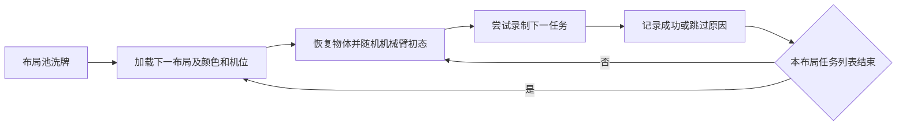

# 按布局顺序采集

日常入口只有 `tools/collect.py`，参数集中在 `config/collection.json`。航空螺栓与其他任务共用正式实现，只在本次默认配置中关闭。

| 顺序 | 任务 | 默认启用 |
|---|---|---|
| 1 | `drawer_cycle` 抽屉开关 | 是 |
| 2 | `aviation_plug_insert` 航空插头拔取插入 | 是 |
| 3 | `guide_plug_insert` 导向插头拔取插入 | 是 |
| 4 | `cylindrical_plug_insert` 圆柱插头拔取插入 | 是 |
| 5 | `locking_rod_cycle` 锁杆松开、折叠、复位、锁紧 | 是 |
| 6 | `aviation_bolt_insert` 航空螺栓旋出装配 | 否 |

每遍将池内布局洗牌、不重复遍历；当前配置 `layout_cycles: 1000` 表示总共 **1000个布局轮次 × 5种任务 = 5000次尝试**，即150套遍历6遍后再取100套。此参数存在时取代 `passes` 的总量设置；设为null时恢复按passes遍历，`--layouts`显式短批参数也关闭总轮次设置。成功数取决于实际结果。每个布局轮次初始化一次七孔颜色、源件颜色和五个固定机位中的一个，随后依序执行启用任务。孔颜色不重复；颜色不改变实际孔件对应关系。每条重新采样六关节相对基准的 ±30° 初态，恢复全部物体、关节速度和控制器状态。任务指令依照当条真实颜色生成英语，保留既有模板选择功能。

初态拒绝、控制任务失败/超时、录后质量不合格均跳过当前任务，**不重试、不补齐成功数**，直接走下一任务；列表走完就换布局。布局准备失败跳过该轮。UE退出或动力学进程异常时关闭本采集器的会话，下一任务重新启动；连续3次运行环境异常仍无法恢复才保存进度并停止。磁盘不可写或可用空间低于20GiB时保存进度停止。这里没有逐布局完整轨迹认证，也不增加试跑任务。

`task_wall_timeout_seconds: 600` 是单条任务实际时间预算，包含准备、初始化和录制。Linux协调器使用独立墙钟闹钟，子录制进程另有超时兜底；600秒到期中止当前任务，清理和文件隔离可能再花数秒，不继续运行该任务。阶段仿真时间限制仍保留。超时清理只写当前条的stop.request，不创建整批cancel.request。人为取消仍停止整批。



## 使用

在 `server/` 下，使用已经安装当前运行依赖的 Python：

```bash
# 只保存计划，不启动 UE 或动力学。
python tools/collect.py --output /absolute/new-run --plan-only
# 按已冻结计划开始/恢复。中断或失败的任务不会自动重试。
python tools/collect.py --output /absolute/new-run --resume
# 新建完整采集批次。
python tools/collect.py --output /absolute/another-new-run
# 短批次验收：两套布局，每套五种任务。
python tools/collect.py --output /absolute/new-smoke-run --layouts 2
```

要正常停止，在输出目录创建 `cancel.request`；恢复前删除此文件，再执行 `--resume`。恢复只运行尚未尝试的任务，并核对冻结配置、基准场景、录制配置和布局池。运行时不要修改源码/资产；若需切换版本应新建输出目录。

配置中的路径相对配置文件目录解析，也接受绝对路径及当前用户主目录 `~`。默认 `layout_pool` 为 `~/data/layout-pools/random150-20261028/pool.json`；布局池与生成资产不随源码提交，换机器时须准备资源池并修改为对应地址。`scene: null` 使用正式场景生成器及 `baseline_joint_deg` 创建基准；提供场景文件时采用文件中的基准关节值。`range_deg` 是每条相对基准的偏移范围。`layout_cycles` 控制总布局轮次；未设置时 `passes` 控制遍历次数，`layouts_per_pass: null` 表示每遍整池，任务的 `enabled` 控制是否参与本批。

## 输出

默认 `seed: null`（或省略seed）在每个新批次启动时取一次 `time.time_ns()`，
将完整纳秒时间戳通过SHA-256映射为31位非负基础种子，再派生布局顺序、颜色、机位和任务初态。
实际整数种子写入 `config.snapshot.json` 并打印到启动日志，各布局/任务种子保存在 `plan.json`。
`--plan-only` 同样冻结种子；之后 `--resume` 使用原种子，不读取当前时间、不重新洗牌。
旧批次的整数种子快照仍可恢复。需要复现实验时可显式填写整数seed；默认新批次使用时间种子。
这是有限范围的伪随机种子，不保证无限次启动绝不碰撞；150套布局池本身不会因此重新生成。

```text
output/
  plan.json, progress.json, config.snapshot.json, inputs.json
  pool.snapshot.json, source-scene.json
  layouts/pass-001/<布局>/initialization.json
  drawer_cycle/pass-001/<布局>/episodes/<episode>/...
  aviation_plug_insert/pass-001/<布局>/episodes/<episode>/...
  guide_plug_insert/pass-001/<布局>/episodes/<episode>/...
  cylindrical_plug_insert/pass-001/<布局>/episodes/<episode>/...
  locking_rod_cycle/pass-001/<布局>/episodes/<episode>/...
  attempts/<任务>/pass-001/<布局>/summary.json
```

失败或录后不合格的视频移到相应任务/布局的 `rejected/`，不与成功的 `episodes/` 混放。`progress.json` 保存成功/跳过数量、原因、耗时及对应详细报告路径；详细状态留在每条日志，避免随批次增长反复重写大量诊断数据。

## 速度与目录职责

UE 跨任务、跨布局复用；动力学进程复用导入和原生库，并默认保留最近一套兼容物理图；每条重置状态，达到条数/RSS阈值或清理异常时回收。默认动力学进程上限从单任务入口的 4 条改为本调度的 50 条，RSS上限仍为8192MiB。相同实际模型内容在动力学进程内复用初态检查和各阶段规划的私有模型，每次查询恢复测量状态；模型/资产内容变化则重建，不跨不兼容模型复用。正常任务失败且清理完成也可以继续复用；运行异常、线程泄漏仍会回收。

保留发布副本精简、NoZen本地DDC、流式veryfast编码、400Hz物理/200Hz腕力/双相机1024² RGB 50Hz、补光与现有任务控制器。首次或布局/机位/颜色切换保留5秒相机预热，同场景复用默认0秒，录制ON应答与末帧双相机屏障保留。初始化仅检查关节限位和初始碰撞，不再做内外两次完整动作预演；路径进入阶段时再规划。采样密度依赖行程和关节变化，手指接近/撤离的近接触区域渐增间距，仍拒绝穿透和腕臂碰撞。

每条先检查任务结果、帧数、时间戳和视频头，状态为 `pending_audit`；全批完成后集中完整解码、状态动作及腕力对应校验，最终才标记 `accepted`。审核失败移至 `rejected/`，不会补录。单任务入口可使用 `--validation-mode full` 恢复逐条完整审核；默认 `deferred` 也会在该批结束前完成审核。审核后移只缩短任务间等待，审核总工作量没有消失。

2026-10-29 完成判据：三插头保留正确孔位、深度、轴线、必要键向、松爪和撤离，几何确认0.2秒；抽屉闭合和锁杆/航空螺栓完成后确认0.3秒。末尾不再要求残余速度近乎为零，操作中夹持/插入/旋拧条件保留。锁杆/航空螺栓在完成撤离且无手指接触后，在线控制与审核统一要求夹爪开度至少0.40 rad净空，不必继续等待较大的配置自由开爪目标；历史版本仍用原配置开度规则。旧版本数据仍使用对应旧规则。这是任务判据调整，不能表述为物理等价提速。

每条 `end_to_end_wall_seconds` 包含当条快速检查；批次 `wall_seconds` 包含最终审核和关闭。`deferred_validation_wall_seconds` 单独记录，不能把它再次加到批次总时间。

| 路径 | 用途 |
|---|---|
| `tools/collect.py` | 日常顺序采集入口 |
| `config/collection.json` | 日常批次配置 |
| `collection/sequence.py` | 按布局调度、输出分组、恢复进度 |
| `collection/collect_scripted_tasks.py` | 单任务批采及共享会话；网页/API继续调用 |
| `collection/record_scripted_task.py` | 正式单条双相机录制 |
| `collection/run_scripted_task.py` | 权威动力学与单任务诊断 |
| `collection/collect_parallel.py`、`config/collection-parallel.json` | 保留的隔离多进程采集模式 |
| `simulation/scripted_tasks/` | 六种任务控制逻辑 |
| `simulation/model_preparation/` | 螺纹、锁杆等物理模型准备函数 |
| `tools/assets/` | 模型生成、布局池准备及UE资产导入 |
| `tools/diagnostics/` | 检查、预览与独立验收工具 |
| `tools/benchmarks/` | 性能分析工具 |
| `tools/deployment/` | 部署、认证及环境检查工具 |

旧平铺路径已迁移，不保留重复转发脚本。网页/API的单任务批采行为保持原约定，未自动切换成这套750次尝试的布局调度。历史实验与旧 `.run` 安装包也不会自动更新。

## 物理图复用（2026-10-31）

兼容性按模型与引用资产内容、运行库/插件、环境、相机、发布步长、子步数、端口、姿态配置和 catalog 内容判断。
同布局、同模型的后续任务可切换任务名与种子；模型、机位或配置改变则重建。锁杆等使用不同模型的任务
不保证复用；外部扰动启用或配置大气阻力时，保守地逐条重建。

复用时重置原生 `mjData`、摩擦状态、所有自由/被动关节、调度时间、姿态控制及计数，重新施加本条轨道与随机初态。
每条创建独立控制通信、渲染会话及任务控制器，清空观察缓存；不调用重新编译发布模型的 `SelfInit`。
运行异常销毁缓存，普通任务未成功但资源清理正常时可继续复用。

动力学 summary 保存 `physics_graph_reused`、`physics_graph_id`、不命中原因，以及
`initialization_seconds.graph_compatibility` / `restore_existing_graph` / `build_physics` /
`initialize_simulation`。复用成功时最后两项为零。版本与过滤模式记录在 `runtime_provenance`。

对照验证可在启动 worker 前设置 `SPACE_SIM_REUSE_GRAPH=0` 禁用图复用。
`CYLINDER_FILTER_MODE`、`MESH_FILTER_MODE`、`THREAD_FILTER_MODE` 的 worker 默认值为 `2`（证明分离才跳过）；
`0` 关闭，`1` 执行原始查询并统计对照。未知几何或无法证明分离的碰撞对仍进入原始求解。
这些开关供受控验证使用；运行中的 worker 不会因源码/环境更新自动升级。
