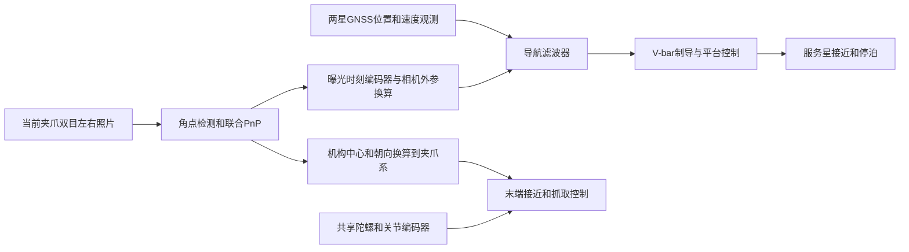

# GNSS、V-bar和当前夹爪双目的关系

更新：2026-10-30。以当前夹爪双目为准，导航适配相机。本文区分任务方案、已实现的模块和整段运行验收。

## 先把三件事分开

**GNSS和双目负责测量，导航滤波器整理测量，V-bar负责让服务星怎么飞，机械臂负责最后怎么抓。**

GNSS给两星的位置、速度观测，导航滤波器估计两星状态及不确定性。双目在能识别靶标时给一份新的相对位姿观测；导航处理它后，V-bar使用更新后的状态控制接近。不能把“沿V-bar飞”和“用GNSS定位”理解成两套互斥方案。



双目不是只给机械臂使用：有效观测也能修正接近导航。它给导航和给机械臂的数据坐标、参考点和用途不同。

## 相机以哪套为准

采用 `config/vision/capture26_near23_front_mount_20261029.json`，父对象为 `teleop/gripper`。左右安装位置分别为 `[0.075, 0.060, 0.031] m`、`[0.075, -0.060, 0.031] m`，光轴朝夹爪−Z；每眼1920×1920、100°视场。两眼光心间距为12 cm（两眼Y坐标相减为0.060−(−0.060)=0.120 m），术语叫“双目基线”；不是到目标的距离，也不是视觉丢失或切换距离。原运行工作区的 `capture26_stereo.json`本次核对也使用同一组夹爪安装位置。使用原23块靶标和原灯光。

本次没有修改该JSON、模型、靶标或灯光，也没有增加固定机位或长焦相机。主线已有固定相机的默认路线仍属于原实现；新接入路线使用当前夹爪双目，不能拿旧固定相机的外参处理新图像。

## 从交会到抓取，什么时候用什么

下表是需要接通并验收的流程，不表示每一行已经在同一次任务中通过。

| 时段 | 用什么定位 | V-bar和平台做什么 | 你的双目/调姿做什么 |
| --- | --- | --- | --- |
| 远距至约110 m交接 | GNSS，导航状态和历史连续继承 | 接近、制动、检查远距交接 | 不要求识别小靶标 |
| 约110 m至50 m、再到17.4 m停泊 | 继续GNSS | 沿质心V-bar接近，每个指定节点实际停稳并驻留 | 识别不到时报告无有效视觉 |
| 17.4 m停稳后 | GNSS＋服务星姿态估计＋目标合作姿态信息 | 暂停继续靠近，配合相机指向和关节准备 | 根据实际相机FK生成目标面对相机的参考，受限力矩转正；之后持续跟踪保持 |
| 继续靠近，视觉尚不可用 | GNSS | 按双方明确选择的规则续行或等待 | 每帧尝试检测；不能因“调姿完成”就输出有效PnP |
| 真正获取合格双目后 | GNSS＋被导航接受的双目观测 | 用融合估计控制接近；视觉就绪和停泊稳定分别检查 | 按10 Hz曝光输出新测量、时刻、协方差和质量；无效就明确报无效 |
| 作业平台停泊与机械臂对准 | 平台保持；视觉提供相对机构位姿 | 从实际停泊/关节/传感器状态继续 | 将机构中心和朝向换算到夹爪系，驱动末端对准和接近 |
| 接触、闭爪和保持 | 接触/力反馈，保留视觉诊断 | 平台控制与接触模式协调 | 短暂缺图时共享陀螺和编码器补偿自身运动；按已有预算停止或继续，最后检查实际抓持力 |

**17.4 m停泊用于调姿，当前相机在这里看不到可用靶标。之前连续试验在约3 m范围开始识别，首条被导航接受的图像记录为约2.623 m；这条历史记录采用当时原机位，不能冒充当前机位已经完成整段复验。** 当前5 cm黑框正视投影在17.4 m约2.315 px、5.5 m约7.323 px，均小于当前12 px筛选门槛。约3.36 m只是12 px的正视几何估算；首次测量和连续稳定就绪仍分别按实际图像及质量判断。

V-bar不是表里额外插入的一步，它贯穿约110 m至作业停泊点的平台飞行。可以直接这样讲：**V-bar用GNSS导航估计带到17.4 m并停稳→触发调姿并持续稳姿→V-bar继续用GNSS估计控制接近→约3 m有合格视觉后，导航融合GNSS和双目，V-bar继续带到作业停泊点→平台保持、机械臂抓取。** 这里描述待接通的导航闭环，不能替代下文对当前默认真值演示和运行验收的区分。

因此，“无视觉保护12 m、5.5 m必须视觉就绪”的旧规则与这套原相机的远处识别能力存在冲突。如何允许GNSS继续接近，是双方要明确修改和验收的任务规则；不能靠换相机、放宽像素门槛或伪造视觉解决。本轮数据接口改动没有自动解除这些限制。

## 你具体给V-bar同学什么

### 每个新曝光历元提供一份测量包

正常不用把左右原图作为飞行控制输入；原图另留作复查。实时交接包含：

| 字段 | 人话解释 |
| --- | --- |
| `status`、`reason` | 这一帧能不能用；不能用的原因。无效包不携带上一次位姿 |
| `sim_time_ns` | 拍照时的仿真时间，不能拿算法算完的时间代替 |
| `mission_id`、`session_id`、`source_frame_id`、`calibration_id` | 来自哪次任务、哪张原图、哪套相机/靶标配置，防止串帧串版本 |
| `pose_target_to_service.t_m` | 目标星**本体原点相对服务星本体原点**的位置，表达在服务星本体系中，单位m |
| `pose_target_to_service.R` | 把目标星本体系方向转到服务星本体系的旋转矩阵 |
| `pose_covariance` | 这6个量的不确定性，顺序为位置xyz（m）、小角度旋转xyz（rad），保留交叉项 |
| `counts`、重投影误差、最短黑框像素边长、正深度 | 用了哪些有效观测，是否满足当前图像质量门槛 |
| `exposure_geometry` | 这一帧曝光时刻的关节编码器、模型指纹和FK相机外参，用来核对转换依据 |

这份**原点到原点的视觉测量**先交导航；当前 `PoseNavigation`保持两星装配质心的位置、速度状态，用曝光时刻的装配COM杆臂处理测量，再预测到当前控制时刻。不要把本体原点、质心、机构中心或PnP的`tvec`混成同一个点。

V-bar实际跟踪的是导航输出的相对质心位置和速度。本次提供的 `relative_navigation_output()`明确输出J2000系“目标质心减服务星质心”；现有V-bar制导内部也使用“服务星减目标星”的量，接收方应显式取反并做旋转系换算。**滤波后的导航输出不能再次当成独立视觉测量送回同一个滤波器。**

### 一次性交付配置

当前相机JSON包含内参、左右外参、夹爪安装外参及靶标三维角点。还需要同一版模型/FK，以及编码器、安装误差的假设。配置和数据包的标定指纹要一致。没有模拟的安装/编码器误差可在仿真诊断中显式设为零；实物误差不能照搬零。

协方差是模型对不确定性的估计，不是“这帧与真值相差多少”。实际误差应在独立评分中对仿真真值计算，不能把真值传回测量或控制。

## 已补的接口与还没通过的整段验收

2026-10-30后续更新：由同一个V-bar负责全段平台接近和驻留、暂停调姿、使用原图导航桥及共享陀螺抓取的独立原生试验，已通过从110 m初始化至四爪约5 N连续保持20 s的验收，见[本轮集成说明](VBAR_NEAR23_INTEGRATION_20261030.md)。首条被导航接受的图像光学深度为2.710466 m，平台驻留末5 s质心位置偏差最大1.276 mm。下面关于正式网页尚未接入、未继承远距检查点的范围仍然成立；本轮也未满足全程导航位置误差小于3 mm。

- `MultiCameraPoseEstimator`的联合双目结果现在用最终保留角点的投影雅可比计算6×6位姿协方差。采用现有0.5 px单坐标标准差下限及4倍方差膨胀，是工程先验，尚需整段覆盖率验证。
- `simulation.near23_navigation.Near23NavigationBridge`用同曝光关节FK将图像位姿转换到服务星本体系，并传播像素、编码器和安装协方差。回放缓存只取完全相同曝光时刻的编码器，绝不拿当前关节替代旧照片的关节。
- `PoseNavigation`和`VisualReadiness`新增显式 `near23_eye_in_hand_v1`模式，接受该包；双眼各至少一块完整有效靶标，不要求同ID，仍检查12 px、2.5/5 px、正深度、歧义、时效、协方差和导航创新。原固定相机默认门槛保留。
- 当前接口已经可以用旧记录的真实左右原图和同历元编码器重新运行；这证明接口和计算可执行，不代表新的全流程已经飞过。
- **正式任务运行时尚未调用该桥接器。** 当前网页默认 `simulation_state_demo_v1`的运动反馈仍来自仿真真值，不能称作已经完成GNSS＋真实双目闭环。新桥接器也尚未替代平台停泊后的展开、接触及力控交接；整段成功要另跑并记录。

调用方式（本仓库Python源码环境）：

```python
# config是当前夹爪双目JSON；下面的零值仅表示本次理想仿真安装/编码器假设。
bridge = Near23NavigationBridge(model, config,
    joint_covariance_rad2=np.zeros((6, 6)), mount_covariance=np.zeros((6, 6)),
    uncertainty_source="ideal simulation mounts/encoders; pixel prior only")
# nav和视觉就绪门需显式选择visual_profile=NEAR23_BODY_PROFILE，
# 并将vision_identity绑定到同一mission/session/bridge.calibration_id。
bridge.remember_encoders(exposure_ns, measured_capture_joint_positions)
packet = bridge.image_result(timestamped_joint_stereo_result)
accepted = nav.visual(packet)  # 真正融合发生在这里；返回False时不得计为视觉就绪。
```

真实原图接口回放（输出为新文件，不覆盖旧实验）：

```powershell
python tools/diagnostics/export_near23_navigation.py --recording <原运行目录> --frame 22 --output run/interface-replay/frame22.json --ideal-sim-geometry
```

可直接发给同学的说明：

> 相机以我现在的夹爪双目为准，会随机械臂移动。我给你带曝光时间、标定版本、协方差和有效标志的相对位姿测量；用同一时刻编码器换算到服务星本体系，再由导航处理两星质心杆臂，供你的V-bar控制使用。看不到就报无效。17.4 m先停泊调姿，不承诺当场识别；GNSS靠近和视觉获取之间的放行规则我们一起接到主流程，不能直接沿用5.5 m必须已识别的旧条件。
