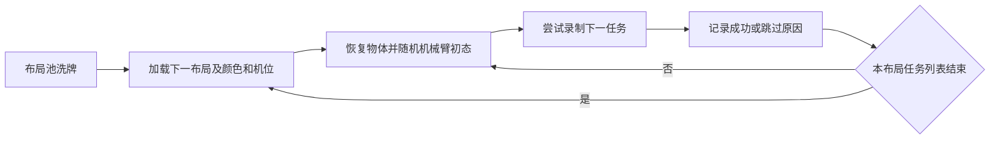

# 按布局顺序采集

日常入口只有 `tools/collect.py`，参数集中在 `config/collection.json`。航空螺栓与其他任务共用正式实现，只在本次默认配置中关闭。

| 顺序 | 任务 | 默认启用 |
|---|---|---|
| 1 | `drawer_cycle` 抽屉开关 | 是 |
| 2 | `aviation_plug_insert` 航空插头拔取插入 | 是 |
| 3 | `guide_plug_insert` 导向插头拔取插入 | 是 |
| 4 | `cylindrical_plug_insert` 圆柱插头拔取插入 | 是 |
| 5 | `locking_rod_cycle` 锁杆松开、折叠、复位、锁紧 | 是 |
| 6 | `aviation_bolt_insert` 航空螺栓旋出装配 | 否 |

每轮将池内布局洗牌、不重复遍历；默认 150 个布局 × 5 种任务 = **750 次尝试**，成功数取决于实际结果。每个布局初始化一次七孔颜色、源件颜色和五个固定机位中的一个，随后依序执行启用任务。孔颜色不重复；颜色不改变实际孔件对应关系。每条重新采样六关节相对基准的 ±30° 初态，恢复全部物体、关节速度和控制器状态。任务指令依照当条真实颜色生成英语，保留既有模板选择功能。

预检拒绝、控制任务失败/超时、录后质量不合格均跳过当前任务，**不重试、不补齐成功数**，直接走下一任务；列表走完就换布局。磁盘/写盘错误、UE 退出、动力学进程异常等基础设施故障保存进度后停止，避免继续产生大量无效数据。这里没有逐布局完整轨迹认证，也不增加试跑任务。



## 使用

在 `space_sim_server/` 下，使用已经安装当前运行依赖的 Python：

```bash
# 只保存计划，不启动 UE 或动力学。
python tools/collect.py --output /absolute/new-run --plan-only
# 按已冻结计划开始/恢复。中断或失败的任务不会自动重试。
python tools/collect.py --output /absolute/new-run --resume
# 新建完整采集批次。
python tools/collect.py --output /absolute/another-new-run
# 短批次验收：两套布局，每套五种任务。
python tools/collect.py --output /absolute/new-smoke-run --layouts 2
```

要正常停止，在输出目录创建 `cancel.request`；恢复前删除此文件，再执行 `--resume`。恢复只运行尚未尝试的任务，并核对冻结配置、基准场景、录制配置和布局池。运行时不要修改源码/资产；若需切换版本应新建输出目录。

配置中的路径相对配置文件目录解析，也接受绝对路径及当前用户主目录 `~`。默认 `layout_pool` 为 `~/data/layout-pools/random150-20261028/pool.json`；布局池与生成资产不随源码提交，换机器时须准备资源池并修改为对应地址。`scene: null` 使用正式场景生成器及 `baseline_joint_deg` 创建基准；提供场景文件时采用文件中的基准关节值。`range_deg` 是每条相对基准的偏移范围。`passes` 控制轮数，`layouts_per_pass: null` 表示整池，任务的 `enabled` 控制是否参与本批。

## 输出

```text
output/
  plan.json, progress.json, config.snapshot.json, inputs.json
  pool.snapshot.json, source-scene.json
  layouts/pass-001/<布局>/initialization.json
  drawer_cycle/pass-001/<布局>/episodes/<episode>/...
  aviation_plug_insert/pass-001/<布局>/episodes/<episode>/...
  guide_plug_insert/pass-001/<布局>/episodes/<episode>/...
  cylindrical_plug_insert/pass-001/<布局>/episodes/<episode>/...
  locking_rod_cycle/pass-001/<布局>/episodes/<episode>/...
  attempts/<任务>/pass-001/<布局>/summary.json
```

失败或录后不合格的视频移到相应任务/布局的 `rejected/`，不与成功的 `episodes/` 混放。`progress.json` 保存成功/跳过数量、原因、耗时及对应详细报告路径；详细状态留在每条日志，避免随批次增长反复重写大量诊断数据。

## 速度与目录职责

UE 跨任务、跨布局复用；动力学进程复用导入和原生库，每条仍新建物理图以恢复状态，达到条数/RSS阈值或清理异常时才回收。默认动力学进程上限从单任务入口的 4 条改为本调度的 50 条，RSS上限仍为8192MiB。相同实际模型内容复用初态预检的私有模型；若锁杆所需的物理初态改变模型，重新编译，不跨不兼容模型复用。

保留发布副本精简、NoZen本地DDC、流式veryfast编码、400Hz物理/200Hz腕力/双相机1024² RGB 50Hz、补光与现有任务控制器。相机预热参数仍沿用5秒，没有通过缩短物理动作、丢帧或取消数据完整性检查提速。

| 路径 | 用途 |
|---|---|
| `tools/collect.py` | 日常顺序采集入口 |
| `config/collection.json` | 日常批次配置 |
| `collection/sequence.py` | 按布局调度、输出分组、恢复进度 |
| `collection/collect_scripted_tasks.py` | 单任务批采及共享会话；网页/API继续调用 |
| `collection/record_scripted_task.py` | 正式单条双相机录制 |
| `collection/run_scripted_task.py` | 权威动力学与单任务诊断 |
| `collection/collect_parallel.py`、`config/collection-parallel.json` | 保留的隔离多进程采集模式 |
| `simulation/scripted_tasks/` | 六种任务控制逻辑 |
| `simulation/model_preparation/` | 螺纹、锁杆等物理模型准备函数 |
| `tools/assets/` | 模型生成、布局池准备及UE资产导入 |
| `tools/diagnostics/` | 检查、预览与独立验收工具 |
| `tools/benchmarks/` | 性能分析工具 |
| `tools/deployment/` | 部署、认证及环境检查工具 |

旧平铺路径已迁移，不保留重复转发脚本。网页/API的单任务批采行为保持原约定，未自动切换成这套750次尝试的布局调度。历史实验与旧 `.run` 安装包也不会自动更新。
