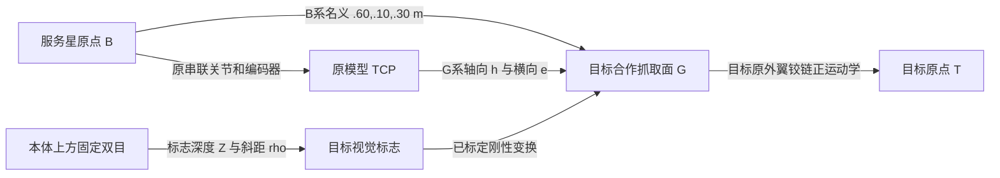

# 100 m 内交会、视觉接管与捕获代理演示

本页保留 2026-10-14 参数化近距实现的设计和验收依据。2026-10-17 已新增真实轨道坐标交接、共享 GNSS、连续任务与关节终态接续，当前行为以[连续任务整合说明](../../archive/2026_10_17_连续任务与共享导航.md)和代码为准；下文的旧分支、独立噪声、惯性 +X 入口及初态演示结果属于历史记录，不代表新链路验收。实现入口为 `simulation/near_field/run.py`。**CaptureHold 仍是逻辑捕获保持代理**，没有焊接约束、载荷传递或真实三爪接触力学验证；双目仍未输入真实左右图像，未执行检测、匹配或 PnP。

本次不修改原模型、CAD、网格、UE 资产、质量、惯量或关节结构。删除旧方案中的激光雷达/激光测距器、独立本体导航单目相机和 MICE 接口选型。原概览/腕部相机只供操作预览，不计入自主导航配置。调研报告保持原样，不作为本轮精度或捕获能力的证明。

## 1. 仓库、分支与已有能力核查

开工时工作区干净，已阅读根 `AGENTS.md`、`CONTRIBUTING.md` 及两个子项目 README。

| 分支 | 开工 SHA | 与当前工作分支关系 |
|---|---|---|
| `feature/100m-rendezvous-integration` | `7930c4de3529502e0ae6bcb1d30f85fc560868fa` | 当前分支 |
| `feature/yipuwang-rendezvous-integration`，含远端 | 同上 | 无差异 |
| `main`，含远端查询 | `662d829d19e5f9a93d9b9bcff14eff77ff9fc86f` | 当前分支领先14提交、落后0 |

本次两子项目的配套变更在当前分支一起交付，不执行合并。新增启动模块、配置和适配器路径已加入根 CI 部署过滤器。

| 阶段与原方案要求 | 实际入口、算法和参数 | 证据层级 | 完成度与缺口 |
|---|---|---|---|
| ① 定轨、300 km 升轨窗口搜索 | `orbital_rendezvous/run.py:FlightControl`，每星六状态 OrbitFilter；独立 GNSS PVT 每轴 σp=3 m、σv=0.5 m/s，2 Hz | 代码存在；历史数值/控制台记录见 TEAM_RENDEZVOUS 及根 archive/2026_10_12、2026_10_13 记录 | 可定轨与跟踪预设参考；没有实装完整窗口搜索器 |
| ② 300→500 km 霍曼转移与修正 | `orbital_rendezvous/reference.py:FlightProfile`，平滑有限推力参考；20 Hz 外层、240 Hz LocalMujocoStepper、25 N 合力及原生飞轮 | 历史独立运行证据；本轮不重新宣称复现 | 不是严格双脉冲霍曼求解器/燃料最优规划；不重写 |
| ③ 建链、30 km→110 m 相对交会、ROE及载波差分 | 同一 run/reference；团队模型支持7 km及升轨任务；`handoff.py` 验证并恢复 accepted handoff | 代码及历史约110 m保持/交接记录；本轮另做接口连续性核查 | 现有两套独立单星 PVT 滤波，**不是载波相位差分**；没有原始观测联合解算或完整 ROE 控制；30 km链路未由本轮验证 |
| ④ 近距接近、视觉辅助/接管 | 新 `near_field/navigation.py` 六状态相对EKF、参数化相对GNSS与双目；`controller.py` 限速平移反馈 | 本轮原生闭环及原网页/UE验证，详见验收记录 | 已实现参数化观测闭环；未验证图像、周跳、多径、照明与遮挡 |
| ⑤ 平台驻留、机械臂对准/末段 | 平台保持＋原姿态控制/飞轮；PBVS、阻尼速度IK及原关节伺服 | 独立静态配置检查、原生动态轨迹、网页与UE | 在限定合作姿态及走廊可复现；不是MPC，不支持任意翻滚目标 |
| ⑥ 接触、夹取、确认/保持 | `ContactProxy→Grasp→CaptureConfirm→CaptureHold`；原两指夹爪开合＋虚拟接触窗口＋逻辑锁存 | 本轮正常与失视觉安全测试 | 完成流程代理；三爪仅工程设计，实际正常轨迹接触数0，无物理连接 |

历史遥操作/交接能力只证明其对应接口，不证明自主视觉导航或自主抓捕。当前机器没有可用的完整远距 accepted handoff 运行数据，因此本轮完整近距验收从 **synthetic 110 m fixture** 开始；不能据此声称①～③在本机连跑完成。

## 2. 交接与适用边界

`--handoff <accepted handoff.json>` 使用远距现有产物；网页的“接续上次110 m交接”读取上次实际远距输出。`--fixture` 明示构造约110 m物理初态和导航协方差，仅用于近距复现。

交接仅在初始化后、传播前调用一次 `apply_handoff`，恢复双星原点位置、速度、姿态、角速度、关节零位与飞轮状态；继承环境RNG状态。星历历元加上已运行的 `sim_time_s`，遥测时间从该时刻接续，内部积分时钟从0计。不在循环中覆盖物体位姿。

远距 GNSS 估计参考装配质心，物理交接参考 body origin。使用已知杠杆臂一次转换：`pO=pCOM-R c`，`vO=vCOM-R(ω×c)`。相对状态 `x=xT,O−xC,O`，`P=P_T+P_C`，不重置为近距小协方差。这里假定远距两个滤波器独立、姿态和编码器精确；以后使用相关差分滤波时必须传递交叉协方差，不能继续盲目相加。

自主入口拒绝未经验证的方向/构型：ECI目标减服务星原点 Δx∈[100,125] m，横向范数<0.6 m，相对速度≤0.05 m/s；双方姿态距本轮identity合作朝向≤1°、角速度≤0.001 rad/s、可动结构为原零位。此限制与模型固定双目朝向和已核查的展开路径匹配。其他方向需要先在远距保持并建立对应走廊，本轮不自动硬转入。

开始5 s保持供相对观测收敛；σp<0.15 m且链路新鲜后进入GNSS接近。真实远距的大协方差可以延长保持；质量不合格时不会跳到视觉精度。传感器精密误差模型在近距启动时是一个显式的新观测服务假设，未证明远距原始载波链路已具备该能力。

## 3. 坐标、距离与驻留几何

N为ECI/J2000；B为服务星原模型body frame；T为目标原点frame；G为合作抓取件frame，其+Z为接近轴。`R_NB`将B向量变到N；TCP为原 `sarm_ee`。所有长度m、角度rad（界面显示°）、速度m/s。控制和遥测分别使用估计量与真值评估量，名字中 `truth_` 不参与反馈。

| 名称 | 定义 | 用途 |
|---|---|---|
| 双星质心距离 dCOM | `||Σm_i p_i/Σm_i − Σm_j p_j/Σm_j||`，每个刚体实时COM加权，含机械臂运动 | 主曲线/总览；不代表表面距离 |
| 平台到抓取点距离 dBG | `||pG−pB,origin||` | 显示驻留位置，不能称本体表面间隙 |
| 平台相对抓取面的轴向驻留 sBG | `zGᵀ(pG−pB,origin)`，另需报告横向分量 | 几何定义；本轮名义sBG=.60，横向(.10,.30) |
| TCP轴向间隙 h | `zGᵀ(pG−pTCP)`，横向误差`||(I−zG zGᵀ)(pG−pTCP)||` | 末段与接触代理条件；正数为尚未到达抓取面 |
| 相机观测深度Z与斜距ρL/R | Z为标志中心在校正相机光轴上的分量，ρ为光心到标志中心的欧氏距离 | 像素/视差门控；不能与h混用 |

原默认模型为 `model/SARM/platform/sarm_ground_target_self_collision.xml`。服务星装配169.398546 kg，目标10 kg（原地面验证目标已有合成质量/包络，不是参考报告中的质量配置）。本轮保持其全部质量、惯量、碰撞geom与关节。

原服务星本体网格B系AABB约为min(-.295,-.265,-.690)、max(.725,.769,.0691)。TCP抓取点选择B系(.60,.10,.30)，比本体上包络高约.231 m；预抓取TCP为(.45,.10,.30)，最终代理点为(.582,.10,.30)。目标零位抓取site在T系(-.3745,-.07242,.04707870013)，目标原点相对平台名义Δ=(.9745,.17242,.2529213)。所以 **dBG=.678233 m，sBG=.60 m，而h在最终约.019 m**；不能用“1 m就是接触”。实时dCOM还随手臂展开而变。

零位到预抓取与预抓取到终点选定同一安全IK分支；参考关节角分别为[76.1517,-64.3266,44.3764,-70.0498,76.1512,-90.0004]°及[82.0419,-82.7746,55.6994,-62.9247,82.0414,-90.0003]°。独立Python MuJoCo每段41个配置检查接触数；原生完整动态运行另检查实际接触。离散采样不等于连续碰撞证明，也没有穷举其他姿态。



## 4. 确定的传感器与通信配置

资料核对日期2026-10-14。标记【厂】为厂家公开规格，【工】为工程初值/采购验收要求，【仿】为本轮运行假设。设备没有装入原质量模型，不声称整星质量、电源、热控或空间鉴定预算闭合。

### 4.1 双星GNSS

确定参考选型为 **Beyond Gravity PODRIX ×2，配套Patch Excited Cup GNSS天线×2**，各星内部安装一台，天线位于各自背离交会面的天顶开放面；天线参考点到body origin杠杆臂需实测标定，本轮直接模拟已补偿后的相对原点观测。主接口选RS-422 UART＋RS-422 PPS到星载计算机，目标经星间通信传送观测和状态。[厂家V1.0资料](https://www.beyondgravity.com/sites/default/files/media_document/2024-04/BG_PODRIX_GNSS_Receiver%20spaceborne_Satellite_RX_V1.0.pdf)

【厂】支持GPS L1/L2/L5、Galileo E1/E5a（E6选件），提供code/carrier及质量数据；双频最多18颗卫星，数据率按观测种类可配置；标准单星位置<1 m **3D RMS**、速度<2 mm/s **3D RMS**，PPS<50 ns **1σ**；这些不是双星相对精度。可选PPP<.2 m也不是载波差分结果。厂家列有空间任务历史及300–1500 km环境范围。电子盒3 kg、平均15 W，配套天线.735 kg、直径200 mm、高87 mm。

【工】原始code/carrier至少1 Hz交换、两星同历元配对；近距相对观测服务目标10 Hz、每轴1σ位置.03 m、速度.002 m/s，时钟对齐≤1 ms、总延迟≤.1 s。公开资料没有承诺本配置10 Hz，必须在订购ICD/处理机吞吐验收中确认。考虑相位模糊度、周跳、共同可见卫星与相关误差的完整双差解算是后续开发。形式为`∇Δρ≈(u_i−u_j)ᵀ r+ε`、`∇Δφ≈(u_i−u_j)ᵀ r+λN+εφ`，需要额外模糊度状态；本轮不声称实现这些方程。

【仿】采用相对GNSS观测`z=[r,v]+n`，R=diag(.03²×3,.002²×3)，10 Hz、100 ms延迟、seed7；没有两套独立单星定位结果相减冒充载波差分。零偏、多径、周跳和失锁重固定未建模，.03 m为显式观测假设，不是厂家保证。单轴.03 m与3D RMS≈.052 m不能混称。

适用性判断：PODRIX能提供空间原始观测，避免用有80 km/500 m/s工作限制的地面RTK模块直接声称LEO适用；但每星3.735 kg和15 W对原10 kg目标是很大的集成负担。此选型仅确定原始观测/接口参考，不认定可在原10 kg硬件上直接加装。保留原仿真质量，飞行工程必须另行封闭质量、电源、安装和采购接口；本轮不偷改质量去满足该产品。参考报告的质量和激光配置均不继承。

### 4.2 一组固定双目

确定 **Basler ace 2 a2A1920-51gcBAS ×2＋Kowa LM6HC 6 mm C-mount镜头×2**。这是成熟**地面工业**配置，没有据此认定辐照、真空、热循环或在轨空间鉴定。[Basler官方规格](https://docs.baslerweb.com/a2a1920-51gcbas)、[Kowa LM6HC规格](https://www.kowavision.com/products/lm6hc)。

【厂】Sony IMX392彩色、全局快门、3.45 μm像元，默认1920×1200、最大51 fps；GigE、RJ45、M8触发I/O、PoE或12–24 V。LM6HC为6 mm，手动对焦.1 m–∞、光圈F1.8–11。不要混用LM6HC-V的参数。

【工】只用一组本体上方双目，B系左右光心(-.10,-.10,.34)、(-.10,-.10,.46) m，基线沿B系Z=.12 m，光轴B系+X；处于本体z上包络之外。两图1920×1200、10 Hz硬件共同触发，两眼曝光时刻差≤.1 ms；曝光≤2 ms、锁焦1 m、F11为首个台架初值，照明/景深/MTF须测试后确定。每眼独立内参和畸变、双目外参、相机-B、标志-G变换及温漂需标定；基线误差目标≤.1 mm、外参转角≤.02°、重投影RMS≤.2 px为验收目标。手动锁焦不等于.7–18 m全距离均清晰；.2 px视差噪声是待验证假设。

【仿】f=6/.00345=1739.13 px；由有效传感器6.624×4.14 mm计算HFOV≈57.8°、VFOV≈38.06°。运行时只添加虚拟相机，不改资产；目标标志80×80 mm，其中心相对G的偏置在光学安装坐标(.10,.08,0) m。末段Z约.697 m，标志约199 px，双目仍有共同视场。没有生成/处理真实左右图像，也未模拟目标/机械臂遮挡及标志朝向投影缩短；近identity合作姿态限制使平行标志近似有明确边界。

标志建议采用刚性刻蚀/贴附高对比四角编码板（80 mm正方形及唯一ID），布置在抓取件附近但避开爪的扫掠区；工程图与G的变换需三坐标测量。允许虚拟标志调试显示，本轮未在目标CAD上制造新件。

### 4.3 星间通信

确定 **GomSpace NanoCom AX100 UHF版×2＋配套同极化UHF天线各1副**，同频半双工，天线位于各星交会侧外部无遮挡区并避开夹具扫掠。设备经UART/CAN与星载机交换CSP数据。[厂家产品页](https://gomspace.com/product/nanocom-ax100/)、[AX100当前产品页所链接的数据表](https://gomspace.com/wp-content/uploads/2025/09/gs-ds-nanocom-ax100.pdf)。它是空间产品系列；具体频段、任务级鉴定文件仍需订货确认。

【厂】UHF430–440 MHz可选段、最高38.4 kbps、24–30 dBm、半双工；RF帧有效载荷受模式限制；按每帧应用载荷不超过200 B的工程初值分片，不将其标为厂家载荷上限。【工】435 MHz、38.4 kbps、24 dBm为本轮参考；没有通信测距。按状态96 B×10 Hz双向=15.36 kbps，原始观测18星×24 B＋32 B=464 B×1 Hz单向=3.712 kbps，指令32 B×2 Hz双向=1.024 kbps，总20.096 kbps，计1.5倍协议/分片/TDMA开销约30.144 kbps。真实原始多频观测若更大必须重算，不允许把原始10 Hz流量塞进此预算；本轮10 Hz相对GNSS服务不代表无线原始观测链已实现。

110 m时FSPL=`20log10(4πdf/c)`≈66 dB。假设Gt/Gr各−3 dBi、总馈线损耗2 dB、极化/姿态损耗6 dB，则Pr≈−56 dBm；接收门限−98 dBm只为工程预算假设，需38.4 kbps对应调制的实测PER/灵敏度确认，不能当厂家保证。近至1 m还须检查输入饱和、AGC与衰减；不据此承诺30 km链路。

包包含时间戳、序号、坐标frame、观测值及R/质量、姿态/角速率、目标铰链编码器、任务阶段/命令/ACK。10 Hz状态，2 Hz命令/ACK，1 Hz原始观测参考通道；命令要求去重/超时，未来实物链实现。仿真只建传输延迟、定时失链和陈旧拒收，不做RF/误码物理仿真；最后有效通信GNSS包> .5 s即锁存SafeHold。

## 5. 已实现的确定算法

### 5.1 六状态相对EKF与质量接管

`x=[rT−rC,vT−vC]`，ECI。预测模型`r_dot=v`，`v_dot=G r−uC/mC`，`G=μ(3rrᵀ/|r|⁵−I/|r|³)`在继承的目标轨道估计处线性化。20 Hz离散预测，连续控制输入按前一周期已下发的力；过程加速度白噪声初值.0003 m/s²。

GNSS H=I6。双目为已补偿相机/目标杠杆臂的等效相对原点三维观测，H=[I3,0]，沿光轴`σZ=sqrt(.0005²+(Z² σd/(fb))²)`，横向`σxy=max(.0003,Z*.2/f)` m，转到ECI形成R；双目姿态附加每轴.05°噪声，本轮无独立姿态EKF。合作目标姿态和铰链编码器是理想测量，经带时间戳星间包延迟送达；本体姿态/关节编码器沿用现有理想测量假设。

按观测stamp计算age并一阶外推位置；R额外加`(age*.003)²+(.5*age²*.02)²`，age>.35 s拒收。NIS门限GNSS30、双目20；Joseph形式更新P以保持半正定，不用真值抹除延迟。此简化延迟补偿不是完整乱序平滑器。

双目有效条件：四角在**左右两眼**校正共同视场内，留16 px边缘、Z>.1 m，目标≥8 px、视差≥2 px。有效后立即融合；主导必须连续10有效帧满足目标≥24 px、σZ<.03 m、EKF位置最大主轴1σ<.04 m。GNSS继续更新，主导指允许继续闭合与机械臂动作，并非停用GNSS。距离只决定限速，不决定传感器硬切。

例如Z=110 m时标志1.26 px，不可用；Z=17.4 m约8 px，深度σ约.29 m，只辅助；Z≈5.6 m标志24.8 px、σZ约.030 m，可逐步达到主导；Z≈.7 m两眼共同视场满足且σZ≈.00069 m。实际转移时刻取决于噪声、门控和协方差，详见实测表。

### 5.2 平台平移与姿态保持

平台目标是`rgoal=R_NB pG,B−R_NT pG,T`；机械臂动作期间平台继续保持。误差e=r−rgoal，`vdes=sat_norm(−.1 e,vmax)`，`uC=mC[G r+.6(v−vdes)]`，三轴合力范数≤25 N，再转B系发给原推进通道。这里相对速度是目标减服务星，因此反馈符号如此。vmax按离名义驻留点的剩余位移：>10 m为.10 m/s，1–10 m为.02，<1 m为.005。限速是参考速度，不保证任何初态真实速度瞬间被夹住；验收另看实际速度/力。

服务星沿用原 `AttitudeControl` 的四元数/角速度反馈和原生飞轮/饱和保护，未更换原轮或改惯量。合作目标本轮用理想有界AOCS力矩`τ=sat(.02 eR−.12 ω,.02 Nm)`保持交接姿态；原目标自由外翼铰链用`τh=clip(−.10 qh−.10 qhdot,±.02 Nm)`及作用于目标的等大反向力矩保持。后两者是运行时合作目标执行器假设，**不是新硬件已实现**，未修改铰链；目标没有平移推力。

未获得有效视觉时，到名义驻留点外12 m停止继续闭合，保留与约17 m视觉有效区的重叠。视觉接管后丢失则锁存SafeHold。达到平台位置误差<6 mm、相对速度<2 mm/s持续5 s，进入驻留并再等5 s。

### 5.3 机械臂与视觉伺服

展开至h=.15 m预抓取点，使用上述已核查分支做原IK求解。关节参考采用统一比例缩放，最大.05 rad/s，保持已检查的关节直线路径。ArmAlign采用PBVS：`vTCP=sat(.8(e−zG h_ref),vlim)`、`ωTCP=sat(.8 Log(Rgoal Rtcpᵀ),.02 rad/s)`；原 `inverse_velocity_ik_pose` 阻尼逆解与关节极限求qdot，原串联关节伺服执行，最大qdot=.08 rad/s。无新增编码器或结构。

ArmAlign平移twist限5 mm/s；满足|h−.15|<4 mm、横向<4 mm、姿态<1°持续2 s后进入FinalApproach。h_ref以1 mm/s从.15降至.018 m；末段twist限1.5 mm/s。关节reference限制在实测q±.03 rad，避免累计不可达命令。目标姿态/标志方向测量假设已知且精确标定，本轮不代表完整视觉六维位姿重建已验证。

### 5.4 捕获与异常状态机

| 阶段 | 距离/区间（只给名义值） | 导航与控制主体 | 进入、退出及速度限制 |
|---|---|---|---|
| FarHandoff | 原点Δx约110 m，质心距离另算 | 继承状态/P；GNSS、通信；平台保持 | 保持≥5 s，σp<.15 m、通信有效 |
| GNSSApproach | dBG约110→17 m | 相对GNSS＋通信；平台及原姿控 | vmax=.1；视觉有效后融合，未有效时在驻留点外12 m止闭合 |
| VisualFusion | 实测约17→5.5 m | GNSS与双目EKF；平台 | 共同FOV、8 px/2 px视差有效；连续10高质量帧后主导；vmax按剩余距离降至.02 |
| VisualApproach | 实测约5.5→.678 m | 双目主导＋GNSS；平台 | 最后1 m vmax=.005；6 mm/2 mm/s持续5 s驻留；失视觉>.35 s保持 |
| PlatformHold | dBG≈.678 m；sBG≈.60 m | 平台保持，臂尚未展开 | 再保持5 s；IK失败安全保持 |
| ArmDeploy/ArmAlign | 平台保持；h→.15 m | 双目与合作状态；原机械臂 | 展开≤.05 rad/s；PBVS≤5 mm/s；4 mm/1°持续2 s |
| FinalApproach | h=.15→.018 m，Z约.7 m | PBVS；平台保持 | h参考1 mm/s；姿态/横向/速度/视觉需持续合格 |
| ContactProxy | .012<h<.021 m，横向<5 mm、角<1°、平台速度<3 mm/s | 虚拟接触窗口 | 该阶段驻留至少1 s，退出时窗口须合格；这不是连续接触力测量 |
| Grasp | h约.019 m | 原两指代理 | 原slide .0375→.002 m，≤5 mm/s；任一窗口失效停止闭合 |
| CaptureConfirm | 手指<.006 m、Grasp≥2 s | 机构编码器与窗口确认 | 条件连续3 s，手指不得>.008 m；然后逻辑latch |
| CaptureHold | 平台/臂继续估计反馈保持 | 逻辑代理，无物理连接 | 保持5 s后成功结束；不宣称动力学捕获 |
| SafeHold | 当前估计相对位置锁存 | 平台制动保持；臂reference停止；手指张开 | 视觉陈旧、失链>.5 s、σp>2 m或夹取条件失效触发；闭合禁止锁存，不自动恢复，保持20 s后结束 |

删除激光后的覆盖结论：在相对GNSS 3 cm假设成立时，从110 m到视觉8 px区没有预设空白，视觉先融合、再按质量接管；近处固定双目避免腕部相机因接近而丢共同视场。**不保证GNSS失锁与黑暗/遮挡同时出现时仍有导航覆盖**。本轮没有照明硬件、图像质量监视或可靠退避规划；遇到丢观测只实现限时安全保持，不能称无限期被动安全轨道或已验证撤离。真实图像阶段应增加曝光/角点/重投影/视差置信度及遮挡检测。

## 6. 三爪配对件工程设计与代理映射

确定采用**合作蘑菇头抓取件＋三根120°径向滑动爪**，不采用MICE或复杂并联机构。[结构示意图](figures/near_field_gripper.svg)给出归属、轴向与工程初值。

目标侧：可更换钢/铝合金蘑菇头，头部Ø40 mm、轴颈Ø20 mm、头部厚6 mm、有效颈长16 mm、根部Ø50 mm安装法兰，入口2 mm×45°倒角；法兰安装到能传载的目标结构上，标志独立刚性支座与G标定。该安装位置在本轮仅映射到原外翼抓取site，不证明原外翼适合真实承载。

服务星末端：三爪导轨120°等分，张开净内径46 mm、闭合颈部内径20 mm，单爪径向行程13 mm；爪端向内钩台在头部背面形成轴向几何保持。单电机驱动平面螺旋盘同步三滑块，带限流、机械止挡及常闭制动保持，避免持续通电依赖和仅靠摩擦。不是复杂空间并联机构。爪/导轨材料、润滑、热胀和真空电机需后续设计验证。

工程进入公差初值：横向≤±3 mm、姿态≤1°、轴向插入速度≤1 mm/s；三爪相位避开目标邻件。以末端小扰动5 N轴向载荷、3倍系数形成15 N初始保持设计点，每爪至少5 N轴向分担；这是结构设计初值，**没有接触、强度、摩擦或疲劳验证**，不得从本轮0接触轨迹推算承载能力。

真实接触条件应是倒角进入、头部越过钩台、三爪在轴颈到位并制动；确认要求三个独立到位开关、制动/电机状态和接触/载荷响应一致。仿真可由真实contact＋机构状态确认；未来实物至少需三爪到位与制动状态硬件，建议腕部六维力矩或独立接触/应变检测用于碰撞停止和保持证明。当前平台没有据此新增力觉，未把电机位置直接当承载证明。

释放流程：平台/机械臂先卸载并保持→确认无拉力→解除制动→三爪径向张开到Ø46→检查三个开位→沿G负Z退到h=.15 m→平台退至视觉安全驻留。若任一爪卡滞停止移动并保持，不允许拉断退出。**本轮只实现异常张开和安全保持，未实现/验收完整捕获后释放状态机**。

代理映射：原两指slide的.0375 m为开位，.002 m为闭位；既不改变手指结构，也不增加蘑菇头碰撞体。h=.018 m附近的几何窗口替代“已进入机构”的演示事件，编码器到位＋3 s替代确认，latch仅设置逻辑标志。没有物体附着/焊接/持续设位；CaptureHold仍靠平台和臂反馈保持。工程三爪开合、接触应力及实际负载传递与此代理无等价证明关系。

## 7. 运行、测试与证据

所有命令从 `space_sim_server/` 执行。使用既有、具备Basilisk/MJScene及当前原生LocalMujocoStepper的解释器；不要将普通Python MuJoCo与Basilisk原生模块混入同一进程。具体环境安装和平台启停见子项目README。

```powershell
$env:SPACE_SIM_PYTHON=(Resolve-Path ../.venv-native/Scripts/python.exe).Path # 改成已有仿真环境
$env:PYTHONPATH="$PWD/backend;$PWD"
& $env:SPACE_SIM_PYTHON tools/build_native_acceleration.py --component local_mujoco_stepper
& $env:SPACE_SIM_PYTHON -m simulation.near_field.run --fixture --config simulation/near_field/configs/nominal.json --output-dir run/near-nominal
& $env:SPACE_SIM_PYTHON -m simulation.near_field.run --fixture --config simulation/near_field/configs/vision_loss.json --output-dir run/near-loss
# 真实远距交接入口，拒绝未accepted或模型hash不同的输入
& $env:SPACE_SIM_PYTHON -m simulation.near_field.run --handoff run/team_rendezvous/<远距任务>/handoff.json --output-dir run/near-resume
```

配置固定seed=7，物理240 Hz、控制20 Hz、两种观测10 Hz，默认最长2500 s；正常闭环约30分钟仿真时间，非实时运行墙钟约数分钟。`--communication-loss <elapsed seconds>`可注入失链；`--vision-loss-phase FinalApproach`或`Grasp`在该阶段持续停止视觉，已在途包仍按时间戳交付。

```powershell
pwsh -NoProfile -File scripts/run_platform.ps1 -Python $env:SPACE_SIM_PYTHON -UnrealRoot D:\UE\UE_5.6 -ApiPort 18000 -PreviewRate 60 -NoBrowser
```

打开原控制台，登录，选择“SARM＋地面验证星”和“110 m初态→近距自主捕获代理演示”，选正常/末段失视觉/夹取失视觉，再启动。接续真实远距时选对应near-field-resume模式。主视窗用现有交会总览/跟随相机；M显示UE任务事件，C自由相机、Home返回。界面显示阶段、dCOM、dBG、h、相机深度、相对速度、横向/角误差、导航源、最大主轴1σ与逻辑捕获状态。UE事件HUD同样带PARAMETRIC STEREO / LOGICAL CAPTURE标记。原相机预览不构成算法输入。UE顶部“Stowed reference distance”沿用零位COM参考供取景，底部COM和网页才是当前装配实时质心距离；机械臂运动后两者可以不同。

拉取后先在适配器目录执行 `scripts/build.ps1`。本轮遇到旧DLL黑屏，以及启动配置关闭补光后运行清单无法重新创建补光的问题；已在 `BskSceneController.cpp` 修复后者并实际重建。近距清单请求100000 lux显示补光及headlight_diffuse_rgb=(10000,10000,10000)的显示增益，仅供演示看清原模型；不改太阳遮挡/SRP、不向导航提供真实图像，也不证明暗处视觉可用。CLI需实时UE时加`--catalog ../space_sim_UE_Adapter/Unreal/BskUnrealRenderer/Saved/AssetImport/sarm_platform.catalog.json --live`；catalog由本机启动脚本生成，不复制别人文件。

只有网页任务或显式带`--catalog`的CLI任务会生成`near_field.bskrec`；不带catalog的CLI仍完整运行数值闭环，但没有UE录制。已录制轨迹可只读回放，不驱动物理：在UE接收器运行时执行下列命令。静态帧用`--at 1825`，整个轨迹用`--speed 20`，不能同时作为当前网页任务的实时状态；UE五行遥测均加REPLAY，网页保留原任务结果。回放使用当前显示灯光，不改录制文件或物理结果。

```powershell
$env:PYTHONPATH="$PWD/../space_sim_UE_Adapter/Adapters;$PWD/backend;$PWD"
../.venv-ci/Scripts/python.exe tools/replay_near_field.py --run-dir run/team_rendezvous/<已录制的近距任务目录> --speed 20
```

独立验收：用另一个只有Python MuJoCo的CI环境执行静态几何核查，使用numpy环境独立从原模型FK、物理状态包、编码器重建真值TCP间隙/横向/角度，复核导航误差、时间、P半正定、力界限、阶段顺序及失视觉后的张开/停止臂reference：

```powershell
../.venv-ci/Scripts/python.exe tools/verify_near_field.py --geometry --output run/near-geometry.json
../.venv-ci/Scripts/python.exe tools/verify_near_field.py --run run/near-nominal --output run/near-nominal/independent.json
../.venv-ci/Scripts/python.exe tools/verify_near_field.py --run run/near-loss --output run/near-loss/independent.json
& $env:SPACE_SIM_PYTHON tools/verify_near_field_handoff.py --output-dir run/near-handoff-continuity
```

验收指标：正常完整阶段顺序、CaptureHold≥5 s、独立真值h∈(.010,.026) m、横向<6 mm、角度<1°、终态真值速度<3 mm/s、力≤25 N、状态有限、P半正定、无传播期间external state writes；失视觉须SafeHold、无latch、近距闭合禁止、夹爪reference只张开、机械臂reference保持。运行回执另报告初始化物理/速度/姿态/角速率/飞轮/时间/估计/P连续性。

详细本轮实际结果、失败记录与截图索引见[根验收记录](../../archive/2026_10_14_近距离交会与捕获代理演示.md)。运行数据、录制、截图与日志位于ignored `run/`、`tmp/`，不加入源码Git。截图必须实际显示模型；仅解码尺寸、黑屏或配置页不能算UE验证。参数化观测验收不能升级为图像级验证或真实捕获。

### 7.1 本轮实际验收结果

正常最终运行`695ecce98c6e497fb5057cdf6a4c9a43`，seed7，1820 s进入CaptureHold并保持5 s。独立验收12/12通过：真值h=18.780 mm、横向=0.149 mm、角=0.0272 deg、终态真值相对速度=0.0871 mm/s，最大合力=10.2568 N，真实接触0、传播期external writes=0。视觉辅助/主导实际发生在929.90/1242.50 s，dBG约17.27/5.48 m。

Grasp丢视觉最终运行`36a7bcdf015947a087513a5ae241d40b`：1810.65 s进入Grasp，1811.00 s锁存SafeHold，禁止闭合、手指只开、臂reference保持20 s、无latch；运行8/8和独立12/12通过。原网页两种任务均completed、UE视频1280×720、无pageerror。正常与失败均从110 m fixture开始，故不升级为①～③连跑验证。交接专项6/6、静态82配置几何4/4通过。

本轮基础验证：服务端803、前端191、适配器88（另3 subtests）、signalling10项通过，UE构建成功，NullRHI自动化33项通过。具体命令、失败与复测日志位置见根验收记录；本轮启动的演示进程已停止。

## 8. 合并与后续边界

2026-10-14 的初次实现未执行分支合并。2026-10-15 在独立 worktree 将源提交 `cc305c3` 整体合入以 `c62c90d` 为基线的 `feature/yipuwang-rendezvous-integration`，包含服务端、前端、适配器HUD、文档及根CI过滤器；该目标已包含当时最新 main `4f1a321`。双方共同祖先为 `7930c4d`，目标后续的任务恢复、腕部测力及性能变更保留。合并后的构建、数值与网页图形证据、环境处理及验证边界见[本次合并验收记录](../../archive/2026_10_15_100m_rendezvous_merge.md)。

尚未通过本轮证明：完整①～⑥从300 km连跑、真实远距accepted产物→近距全程、原始载波差分、10 Hz实物GNSS链路、RF实测、真实左右图像算法、照明/遮挡/变焦、任意目标姿态、接触力学/负载传递/三爪结构强度、捕获后释放及无限时失链安全。以上为后续需求，不改变本轮可复现流程代理的证据范围。
