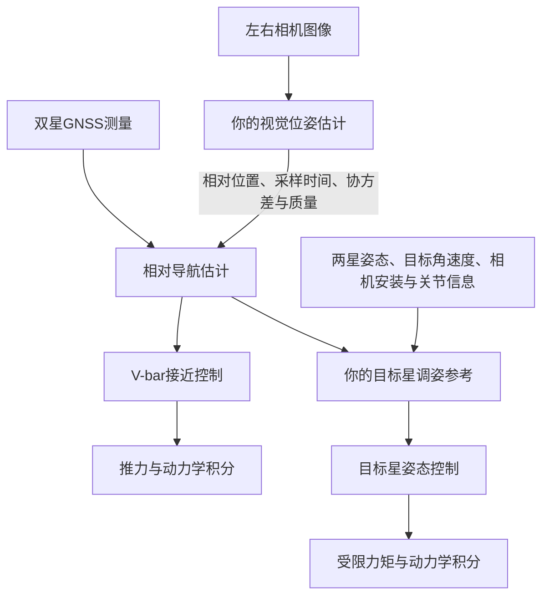

# 席梓杰：GNSS已有内容、目标星调姿起点与视觉交接

> 2026-10-30上传说明：本文件保留2026-10-28/29试验的配置与结果口径；当前整合范围、机位版本和复验入口以[本周工作总入口](WEEKLY_TARGET_POINTING_VISION_20261030.md)为准。文中运行数据与视频仅本地保存，未提交Git；历史成功或失败不自动代表最新组合版本验收。


核查日期：2026-10-28。远端：`https://github.com/love-of-city/space_sim_server.git`。
本次 fetch 后的 `origin/main` 是 `ddea83ce6a30386d4eeb8a08b96650901747590d`，最近提交时间为2026-10-26 13:37（北京时间），包含10月26日合入的交会/GNSS更新及服务星陀螺观测修正。

本次准备位于独立工作区 `space_sim_target_attitude_20261028`，分支 `feature/cooperative-target-pointing-20261028`，基于上述主线。当前双臂实验工作区 `space_sim_main_dualarm_20261022` 没有合并本次代码。23块方形靶标、末端双目参数、场景灯光及网页均保持原配置。本次没有提交或推送。

## 1. 先把三件事区分开

- **GNSS相对导航**估计两颗星的位置关系和相对速度。GNSS本身不提供本任务所需的目标星三轴姿态。
- **V-bar制导与接近控制**规定沿目标轨道前后方向怎样飞、何处停，以及用导航估计计算推力。它在视觉接入前后都可以工作。
- **你的视觉与目标星调姿**分别提供图像测量、把靶标面朝向相机。这两项相关，但调姿可以先依赖GNSS导航估计和合作姿态遥测开展。



因此，仍然需要向负责V-bar接近的导航模块提供视觉测量。视频和“看到了靶标”的标志不能替代可供滤波更新的测量。

## 2. GitHub上已经有哪些内容

| 文件 | 已有能力 | 当前边界 |
| --- | --- | --- |
| `simulation/differential_gnss.py` | 双星GNSS接收机解级测量、共同误差、相对状态和联合协方差 | 不是原始伪距/载波解算，也不是GNSS测姿 |
| `simulation/gnss_transport.py` | 带物理时间戳和延迟的导航传输、预测 | 需继续保留采样时刻和在途包 |
| `backend/space_arm_platform/gnss_config.py` | 远近距共享参数，默认10 Hz，相对位置每轴残差1σ=0.03 m | 该数值是仿真模型假设，不是实测硬件精度 |
| `simulation/orbital_rendezvous/handoff.py` | 远距到近距的实际状态、导航与消息状态继承 | 不应在交接时用理想状态替换实际状态 |
| `simulation/near_field/navigation.py` | 六维相对EKF、GNSS与视觉更新 | 当前视觉更新使用三维相对位置 |
| `simulation/near_field/controller.py` | 合作目标星受限力矩控制、合作姿态与角速度遥测 | 目前跟随轨道姿态参考；目标星执行器是等效外力矩，未细化飞轮/推力器 |

主线近距视觉仍是参数化观测，README明确说明尚不代表实际图像闭环。不能把主线数值任务通过等同于当前23块靶标的图像接近任务已接通。

## 3. 调姿需要谁给什么

| 提供方 | 你需要的输入 | 用途 |
| --- | --- | --- |
| 相对导航模块 | 当前时刻的位置估计、协方差、最近有效测量的采样时间及有效性 | 算目标到相机的大致视线方向 |
| 服务星姿态模块 | 服务星本体到J2000的旋转及时间戳 | 将相机安装位置转到共同坐标系 |
| 机械臂/安装模型 | 关节测量与正运动学得到的相机中点位置、标定外参及时间戳 | 末端相机会随机械臂运动，不能一直使用固定本体坐标 |
| 合作目标星 | 自身姿态、角速度及遥测时间戳 | 判断当前朝向与目标朝向差多少，并反馈控制 |
| 任务方案 | 靶标面法向、参考点、约定的画面上方向及允许调姿阶段 | 消除绕视线方向的自由转动，避免近距接触时自行调姿 |

当前 `RelativeEKF.x[:3]` 的含义是“目标星本体原点减服务星本体原点”，分量沿J2000轴，单位m；后三项是对应速度。它不等于机构中心到爪子的距离，也不一定等于质心间距。相机和靶标参考点的安装偏移必须计入。

GNSS只解决上表第一项所涉及的位置/速度测量。姿态和角速度来自单独的合作遥测；本次独立测试明确采用理想姿态/角速度遥测，不能称为已验证了真实姿态传感器。

2026-10-28补充复核：原主线GNSS可以支持17.4 m停泊后的继续接近；没有有效视觉时，控制器会在12 m光学保护边界外提前制动，这不是GNSS硬件最近距离。当前单次相对位置测量每轴1σ约3 cm，短距离下基本不变；未据此验证纯GNSS毫米级抓取。[距离、精度与控制规则的复核记录](GNSS_PROXIMITY_REVIEW_20261028.md)含测量抽样、8项控制分支检查及完整运行限制。

## 4. 本次已写的代码与验证

新增 `simulation/cooperative_pointing.py`，尚未接入主线任务控制器或运行中的网页场景：

1. `camera_facing_reference()`：用导航相对位置、服务星姿态、相机安装位置、目标靶标参考点和上方向，生成目标星期望姿态，使目标本体+Y靶标面法向朝向相机。该辅助函数限定用于远于1 m的预对准；近距抓取阶段需另行协调。
2. `bounded_pointing_torque()`：根据目标星姿态、角速度和期望姿态/角速度输出本体系力矩，默认范数上限0.02 N·m。专门处理180°背向时旋转误差不能错误变成零的问题。运行中输出力矩，不能直接覆盖目标星姿态。
3. `pointing_status()`：检查四类输入是否有效、是否过期，以及姿态误差、角速度误差和导航不确定度。它只给出瞬时对准状态，不代替任务放行。

基本检查共69项通过：

```powershell
python -m pytest tests/test_cooperative_pointing.py tests/test_differential_gnss.py tests/test_gnss_transport.py tests/test_near_field.py -q
```

独立动力学工具：`tools/diagnostics/validate_cooperative_pointing.py`。
它读取主线目标星及两块面板在零关节位姿下的质量、质心和惯量，合并成10 kg自由刚体；采用Basilisk原生MJScene的RKF45积分，名义物理频率240 Hz、控制频率20 Hz。使用共享GNSS接收机噪声和相对EKF，位置真值仅用于生成GNSS模拟观测；调姿反馈中的姿态和角速度是明确声明的理想合作遥测。参考生成没有读取目标位置真值。

测试中的服务星及机械臂固定，相机安装坐标为工具内显式列出的示例，不是已经从双臂场景读出的实时安装坐标。无轨道引力、关节运动、碰撞、图像或灯光参与；不是完整航天器执行器或对接验证。

| 初始姿态偏差 | 初始角速度 | 达到对准且连续保持5 s的时刻 | 该时刻姿态误差 | 该时刻角速度误差 |
| --- | --- | --- | --- | --- |
| 0° | 0 | 5.00 s | 0.0169° | 0.0000192 rad/s |
| 30° | 0 | 38.80 s | 0.1561° | 0.0000653 rad/s |
| 90° | `[0.01, -0.015, 0.005]` rad/s | 42.25 s | 0.4215° | 0.0006132 rad/s |
| 180° | 0 | 58.45 s | 0.0519° | 0.0003227 rad/s |

各案例绕同一测试轴`[1,2,3]/√14`施加初始偏差，不代表所有方向已遍历。判据为姿态误差<1°、相对参考角速度误差<0.001 rad/s、导航位置主轴σ<0.05 m及各输入新鲜，连续5 s。四项均通过；输入过期会撤销瞬时就绪。

导航过程加速度噪声采用主线未稳姿时的0.05 m/s²，不能套用静稳阶段的低噪声假设：目标本体原点不在质心，转动时该原点也会加速。测试没有靠重置导航状态或放宽姿态/角速度判据通过。

原始证据保存在忽略目录 `run/cooperative_pointing_20261028/summary.json` 和四份 `angle_*_trace.jsonl`；脚本可用以下命令复算（`--source-model`指定实际主线模型XML或其原样副本）：

```powershell
python tools/diagnostics/validate_cooperative_pointing.py --source-model model/SARM/platform/sarm_ground_target_self_collision.xml --output run/cooperative_pointing
```

前期默认Basilisk环境加载MuJoCo 3.11.0，而主线LocalMujocoStepper辅助库要求3.7.0。以上简化调姿结果使用Basilisk原生积分路径。后续已找到原双臂试验保存的兼容运行时，13项LocalMujocoStepper测试通过，并新增GNSS原双臂动力学诊断，见[实际动力学报告](GNSS_DYNAMICS_AND_VISUAL_OVERLAP_20261028.md)。没有放宽版本检查；新增诊断不使此前简化调姿自动成为完整任务验证。

## 5. 下一步从哪里接

执行顺序调整（2026-10-28）：按用户要求，先开展目标星预对准，不等待17.4 m视觉输出类型及精度门槛最终确定。当前只确定调姿自身的验证条件；不把调姿通过作为视觉就绪或继续接近的放行条件。

本次核对实际实验配置：左右相机都挂在`teleop/gripper`，在抓夹坐标系中的中点是`[0.06, 0, 0.05] m`，**光轴沿抓夹−Z**，基线0.12 m。主靶标面为目标本体+Y；`rig.json`含23块方形靶标。以上来自现有配置，未改参数。相机配置SHA256仍为`163c28b94c69088a4f9dce66662b4e4edc4b0b5734307d23a441ce10aa5a790f`。上一轮“光轴沿抓夹+X”的说明有误：渲染相机以自身+X为前向，OpenCV光学系以自身+Z为前向，两者必须先转换到同一坐标系。

注意，中点`[0.06, 0, 0.05]`是在抓夹坐标系中，不能直接填入要求服务星本体系坐标的`camera_midpoint_service_m`。新增`simulation/end_stereo_pointing.py`现已利用同一时刻的抓取臂关节与正运动学完成转换，同时得到实际光轴和图像上方向；渲染安装与光学外参不一致时拒绝加载。核对记录在`run/cooperative_pointing_20261028/prealignment_setup.json`，新验证结果见[实际安装与视觉导航接口验证](END_STEREO_POINTING_HANDOFF_20261028.md)。

本阶段采用已有独立测试的暂定条件：姿态误差<1°、相对参考角速度误差<0.001 rad/s，连续保持5 s，且导航和合作遥测有效、新鲜。完整场景接入时，还应检查主靶标参考区域位于两眼前方和视场内、靶标正面朝向两眼。这是朝向与取景的几何检查，不要求此时已能解码，也不证明实际图像无遮挡或已能可靠测姿。

视觉验收条件仍需与导航方共同确认。当前EKF已有三维位置测量更新接口，可以作为讨论起点；若17.4 m只能提供视线方向，则需相应的观测模型，不能直接当作现有三维位置观测输入。

1. **先接预对准输入**：用主线导航估计、独立合作姿态遥测及实际末端相机正运动学替换独立工具的固定输入。与V-bar同学确认在远距接近/停泊的哪个阶段允许调姿，确认参考上方向、相机指向及完成握手。
2. **接目标星实际动力学与停泊判据**：复用已有等效力矩通道，替换目标星姿态参考；同步修改与参考姿态相关的停泊检查。不能只改期望姿态、却仍拿旧轨道姿态判据阻止放行。保留视场、链路、走廊、制动和连续稳定条件；输入失效时撤销对准就绪，动作由任务异常策略接管。
3. **将真实图像测量交给导航**：提供采样时间、坐标系、图像求得的相对位置/姿态、协方差或经验证的不确定度及质量/拒绝原因。适配到现有视觉EKF更新时，转换成同一时刻的目标本体原点相对服务星本体原点的位置，不能直接传某块靶标的`tvec`或机构中心到爪子的距离。
4. **验证连续交接**：先检查转正和稳住，再检查实际图像是否合格，再测试导航是否接受观测及接近控制能否接续。最后验证平台驻留到机械臂视觉抓取的交接。

17.4 m只是原参数化相机方案的名义视觉节点，不等于当前图像算法已能工作。现有1920×1920、100°视场下，5 cm黑框在17.4 m处正对相机也只有约2.315 px。目标星转正只能改善朝向，不能补足编码像素；远距视觉的成像与靶标方案仍需单独确认，当前23块靶标先保持原配置。
